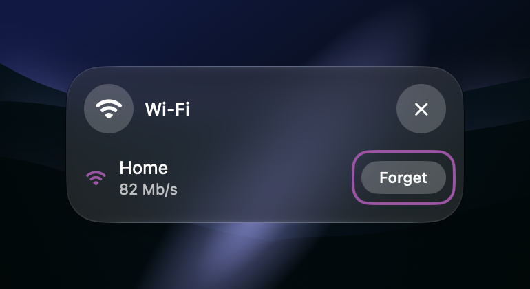

# Openspot guide

In this guide, you build spots, the small tools that Openspot shows in its panel. Each task starts from a whole spot
that works, so you can copy it, try it and change it. The [protocol](PROTOCOL.md) holds every rule, and
[Use Openspot](USING.md) says what the person who uses your spot can choose.

## Build your first spot

Build a spot when you want a small tool one key away. This one lists each process that's listening on a port, and
stops the one you press, such as a server that's still running on :3000.

A spot is a folder in `~/.config/openspot/spots`. Make a folder named `ports.spot`, and save the file that names your
spot as `ports.spot/spot.toml`:

```toml
title = "Ports"
icon = "network"
```

Save the script beside it, named like the folder, as `ports.spot/ports.sh`:

```sh
#!/bin/sh
. "$OPENSPOT_SH"
case "$1" in
  show)
    lsof -nP -iTCP -sTCP:LISTEN | awk 'NR > 1 && !seen[$2]++ {
      sub(/.*:/, ":", $9)
      print $2 "\t" $9 "\t" $1
    }' | openspot_items
    ;;
  press) kill "$(value item)" ;;
esac
```

<!-- draw: lsof() { printf 'COMMAND PID USER FD TYPE DEVICE SIZE NODE NAME\nnode 4120 me 21u IPv4 0x1 0t0 TCP *:3000 (LISTEN)\npostgres 812 me 7u IPv4 0x2 0t0 TCP 127.0.0.1:5432 (LISTEN)\npython3 5051 me 3u IPv6 0x3 0t0 TCP *:8080 (LISTEN)\n'; }; . "$EXAMPLE" -->

The sheet of Ports lists a row for each process that listens, with its port as the title and its name under it.

1. Run `chmod +x ports.sh` in the spot folder. Openspot loads the spot, and its card shows in the panel.
2. Press `⌃Space`, then press the Ports card. Its sheet opens with a row for each port.
3. Press Return on a row. The process stops, and the panel closes.

Each run of your script is a call, and its first argument names the handler: `show` asks what to show, and `press`
says that the person pressed a row. What `show` prints is a frame, a block of `key=value` lines for each row. You can
run a call yourself with `openspot spot run ports show`, and see what it prints.

Learn more in [A spot](docs/protocol/01-spot.md) and [Try your spot](docs/protocol/01-spot.md#try-your-spot).

## Add an action

Add an action when your spot does something the person runs by name, such as moving a window. A table
`[actions.<id>]` declares each action, and running it calls the handler of its id.

`windows.spot/spot.toml`:

```toml
title = "Windows"
icon = "macwindow"
uses = ["screen"]

[actions.full]
title = "Full screen"
icon = "rectangle.inset.filled"

[actions.left]
title = "Left side"
icon = "rectangle.lefthalf.inset.filled"
```

`windows.spot/windows.sh`:

```sh
#!/bin/sh
case "$1" in
  full) openspot window move "0 0 1 1" ;;
  left) openspot window move "0 0 1/2 1" ;;
esac
```

1. Type `left` in the panel. The search lists Left side, with its icon.
2. Press Return on it. Openspot runs `windows.sh left`, and the front window fills the left half of the screen.
3. Add Windows to the grid in Edit Spots, the view of the panel where you arrange its cards, since a spot with an
   action that has a title starts off the grid. Then press `⌘` Return on its card. Its Settings list a key for each
   action, which the person records.

`uses` names the features of the Mac that your spot uses, here `screen` for `openspot window move`. A spot with an
action that has a title has no sheet unless its `[on]` asks for one, so a press of the Windows card runs its first
action, as [Actions](docs/protocol/06-actions.md#actionsid) says.

Learn more in [Actions](docs/protocol/06-actions.md) and [The openspot command](docs/protocol/09-commands.md).

## React to an event

React to an event when your spot shows something that changes, such as the free space on your disk. The `[on]` table
lists the triggers, the things that call a spot by themselves.

`disk.spot/spot.toml`:

```toml
title = "Disk"
icon = "internaldrive"

[on]
"panel.open" = true
every = 300
```

`disk.spot/disk.sh`:

```sh
#!/bin/sh
free=$(df -h / | awk 'NR==2 {print $4}')
printf 'frame=\ndetail=%s free\n\nitem=free\ntitle=%s free\n' "$free" "$free"
```

<!-- card: wide -->
<!-- draw: df() { printf 'Filesystem Size Used Avail\n/dev/disk 994Gi 738Gi 256Gi\n'; }; . "$EXAMPLE" -->


The wide card of Disk shows its icon, the title Disk with 256Gi free under it, and an arrow at its end.

1. Add Disk to the grid in Edit Spots, since a spot with `every` starts off the grid too.
2. Free some space, and open the panel again. The card shows the new value.

`"panel.open" = true` calls `show` each time the panel opens, and `every = 300` calls `every` every 5 minutes while the
card shows. The first block, `frame=`, is the root, which holds the frame's own keys. Its `detail` is the line under the
card's title.

Learn more in [Triggers](docs/protocol/08-triggers.md), [The root](docs/protocol/01-spot.md#the-root) and
[Places](docs/protocol/05-places.md).

## Use another spot

Use another spot when one of your steps is another spot's job, such as picking a time. A binding names the other
spot, and your spot runs one of its actions and waits for the values it gives back.

`remind.spot/spot.toml`:

```toml
title = "Remind me"
icon = "bell"
uses = ["timer"]

[bindings]
picker = { spot = "openspot/snooze" }

[actions.remind]
inputs.words = { type = "text", required = true }
```

`remind.spot/remind.sh`:

```sh
#!/bin/sh
. "$OPENSPOT_SH"
case "$1" in
  show) printf 'button=later\ntitle=Remind me later\nscope=spot\n' ;;
  later)
    picked=$(openspot run picker.pick title="Remind me later" --out until)
    case $? in 0) ;; 4) exit 0 ;; *) exit 1 ;; esac
    openspot timer add "$picked" remind words="Look at this again"
    ;;
  remind) openspot toast "$(value words)" ;;
esac
```

1. Choose Remind me later in the ⌘K menu. The tiles of Snooze, a spot of Openspot, show over the sheet.
2. Pick Tomorrow. `openspot run` prints the time, and the spot adds a timer that calls `remind` then.
3. Press Esc instead. `openspot run` exits 4, and the call ends with no failure.

`scope=spot` puts the button in the ⌘K menu of the spot, whatever row is selected. The `case $?` line reads how
`openspot run` ended: 0 when the person picked a time, 4 when they closed the tiles, which isn't a failure, and any
other code when something went wrong.

`openspot spot actions openspot/snooze` prints the actions you can run, with their inputs and outputs. `pick` takes an
optional `title` and gives `until`, a time that `openspot timer add` takes.

Learn more in [Other spots](docs/protocol/10-other-spots.md) and
[openspot timer](docs/protocol/09-commands.md#openspot-timer).

## Lay out a sheet

Lay out a sheet when a list isn't enough, such as a row with an icon, some words and a button. A `box` block holds the
blocks whose `parent` names it, and its classes, the class names of Tailwind CSS, say how it lays them out.

`wi-fi.spot/spot.toml`:

```toml
title = "Wi-Fi"
icon = "wifi"
```

`wi-fi.spot/wi-fi.sh`:

```sh
#!/bin/sh
printf 'frame=\nclass=gap-part\n\nbox=head\nclass=flex-row items-center gap-2\n\n'
printf 'icon=wifi\nparent=head\nvalue=wifi\nclass=text-accent\n\n'
printf 'text=name\nparent=head\ntitle=Home\ndetail=82 Mb/s\nclass=grow\n\n'
printf 'button=forget\nparent=head\ntitle=Forget\nclass=rounded-full\n'
```


The sheet shows one row: the Wi-Fi icon in the accent colour, Home with 82 Mb/s under it, and a Forget chip at its end.
An `icon` block draws the icon that its `value` names, as a `number` block draws its number.

1. Remove `class=grow` from the `text` block. The chip moves next to the words, since no block takes the free width.
2. Press Forget. Openspot runs `wi-fi.sh forget`.

Learn more in [Layouts](docs/protocol/04-layouts.md) and [Blocks by kind](docs/protocol/03-blocks.md).
