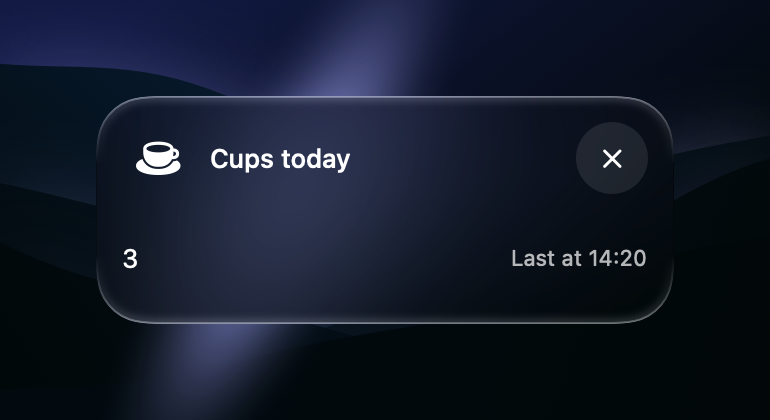
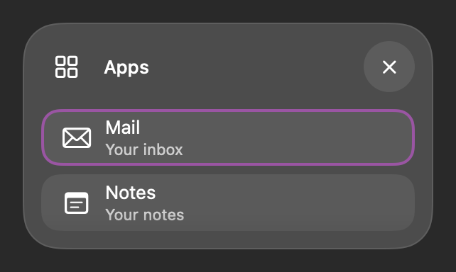
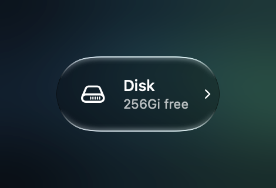
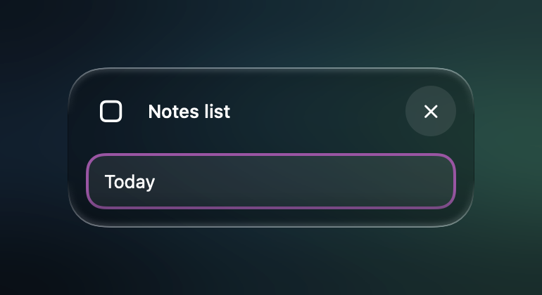
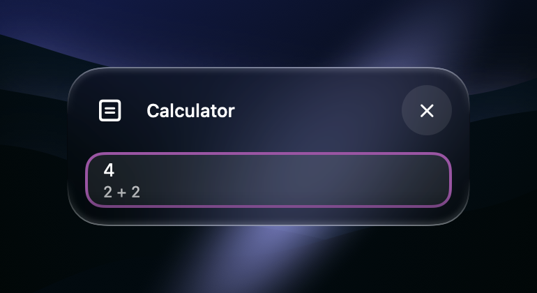
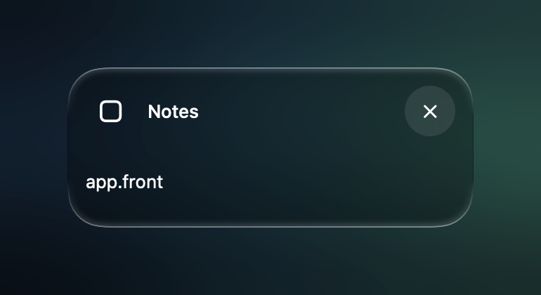
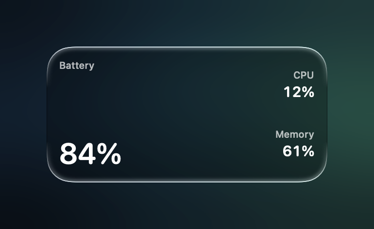

# Openspot guide

Openspot runs small programs called spots. You write a spot in any language. It prints a few lines that say what to
show, and Openspot draws them. When something happens, such as the user opening the spot, Openspot runs it again.

This guide shows how to write one, a task at a time. The [protocol](PROTOCOL.md) gives every rule.

## How it works

Press the Openspot hotkey, and the **panel** opens. It has a search field, and a grid of **cards** under it. Each card is
a spot. Press a card, and its **sheet** opens: a bigger view of that spot, with its text, its controls and its list.

A spot is a script in a spot folder, such as `cups.spot/cups.sh` in the spots folder. Openspot runs it when something
happens, the spot prints what to show, and Openspot draws it. When the user presses something, Openspot runs the spot
again with the id of what was pressed. The [protocol](PROTOCOL.md) gives every rule of that loop.

## Your first spot

The smallest spot is a script. Press its card, and it runs.

```sh
#!/bin/sh
say hello
```

Comment lines at the top give it a name and an icon. These lines are the **header**.

```sh
#!/bin/sh
# title=Morning
# icon=sun.max
open -a Calendar
```

To show something, add an `on=` line. It tells Openspot when to ask the spot what to show. Here, Openspot asks when the
sheet opens, and the spot prints a title and a detail.

```sh
#!/bin/sh
# title=Cups today
# icon=cup.and.saucer.fill
# on=sheet.open
printf 'text=cups\ntitle=3\ndetail=Last at 14:20\n'
```



Each group of lines that the spot prints is a **block**: here, one `text` block with the id `cups`. The sheet shows **3**,
with **Last at 14:20** at the end of the line.

## Try your spot

Try each example of this page in the playground before you put it in the spots folder.

- **Playground.** Open the Playground spot, or run `openspot sandbox [file]`. Type a spot, or pick one from Examples.
  It runs in a panel of its own: pick its sheet or its card, and type in the panel's search to try its answers. Under
  it, you see each call with its arguments, its stdin, what it printed, its stderr and how it ended. When you open a
  file, edits go straight to the file.
- **New spot.** `openspot spot new <name> --from <kind>` writes a working spot that you can change. The kinds are
  `button`, `list`, `number` and `form`.
- **One call.** `openspot spot run <id> [call] [value]...` runs one call the way Openspot does, and prints everything the
  spot prints. With no call, it asks the spot what to show.
- **Image.** `openspot render [--view <file>] <file.png>` draws the sheet that stdin holds. `--card <size>` draws its card,
  and `--spot <id>` draws an installed spot.
- **Log.** `openspot spot log <id>` prints the last calls to a spot, with their stdin, stdout, stderr and exit code.
- **Check.** `openspot check [--json] <folder>` loads each spot, runs it once, and prints each error. Run it before you
  share a spot.

## Show a list

A list lets the user search and pick. Print one `row` block for each item. When the user picks a row, Openspot runs your
spot with `open` and the id of the row.

```sh
#!/bin/sh
# title=Apps
# icon=square.grid.2x2
# on=sheet.open
. "$OPENSPOT_SH"
case "$1" in
  read) printf 'Mail\tMail\tYour inbox\tenvelope\nNotes\tNotes\tYour notes\tnote.text\n' | openspot_rows ;;
  open) open -a "$2" ;;
esac
```



The sheet shows two rows, **Mail** and **Notes**. Type in the sheet's search field, and Openspot filters the rows for
you. Pick **Notes**, and Openspot runs `apps.sh open Notes`.

The first argument tells your spot what to do. `read` asks what to show. Any other word is something the user did. The
shell helper, `$OPENSPOT_SH`, prints rows for you and escapes each value.

Learn more in [Rows](PROTOCOL.md#rows) and [The calls](PROTOCOL.md#the-calls).

## Show a value on a card

A card can show one live value, such as free disk space. `on=panel.open` asks your spot each time the panel opens, and
`on=clock.300` asks it again every 5 minutes while the card shows.

```sh
#!/bin/sh
# title=Disk
# icon=internaldrive
# on=panel.open
# on=clock.300
free=$(df -h / | awk 'NR==2 {print $4}')
printf 'detail=%s free\n\ntext=free\ntitle=%s free\n' "$free" "$free"
```

<!-- card: wide -->
<!-- draw: df() { printf 'Filesystem Size Used Avail\n/dev/disk 994Gi 738Gi 256Gi\n'; }; . "$EXAMPLE" -->


The first block, `detail=…`, is the **head**: it isn't drawn, and its `detail` becomes the line under the card's title.
The `text` block is the spot's **main block**. The user can put the spot in the menu bar, where the main block shows
next to the clock.

A spot with a clock stays off the grid until the user adds it, so that a new spot doesn't fill the panel.

Learn more in [The main block and the card](PROTOCOL.md#the-main-block-and-the-card) and [Events](PROTOCOL.md#events).

## Add buttons

A button runs a command. Give each button an id. When the user presses it, Openspot runs your spot with that id.

Buttons in the header turn the spot into a set of commands, with no card. The user finds each command in the main
search, and can give it a hotkey.

```sh
#!/bin/sh
# title=Windows
# icon=macwindow
# uses=screen
#
# button=full
# title=Full screen
# icon=rectangle.inset.filled
#
# button=left
# title=Left side
# icon=rectangle.lefthalf.inset.filled
case "$1" in
  full) openspot window move "0 0 1 1" ;;
  left) openspot window move "0 0 1/2 1" ;;
esac
```

A button that the spot prints acts on its rows. If no layout places it, it shows in the ⌘K menu of the sheet, and its
shortcut works while a row is selected.

```sh
#!/bin/sh
# title=Notes list
# on=sheet.open
. "$OPENSPOT_SH"
case "$1" in
  read)
    openspot_row today Today
    printf '\nbutton=trash\ntitle=Move to Trash\nshortcut=cmd+backspace\nconfirm=Press again to delete\n'
    ;;
  trash) rm -f "$OPENSPOT_DATA/$2" ;;
esac
```



Select **Today** and press ⌘⌫ twice, and Openspot runs `notes-list.sh trash today`.

Learn more in [Buttons and actions](PROTOCOL.md#buttons-and-actions).

## Ask for values

A button with `form=true` asks the user for values before it runs. Openspot runs it once with empty stdin to get the
form, then again with the values the user typed.

```sh
#!/bin/sh
# title=Quick note
# on=sheet.open
. "$OPENSPOT_SH"
case "$1" in
  read) printf 'text=hint\ntitle=Press ⌘K to add a note\n\nbutton=add\ntitle=Add note\nform=true\nscope=spot\n' ;;
  add)
    note=$(value note)
    if [ -z "$note" ]; then
      printf 'title=New note\n\nfield=note\ntitle=Note\n'
    else
      printf '%s\n' "$note" >> "$OPENSPOT_DATA/notes"
      openspot_kv toast "Saved"
    fi
    ;;
esac
```

Choose **Add note**, and a form with one field opens. Type a note and press Return. The spot saves it, and a toast says
**Saved**. `value note` reads the field from stdin.

Learn more in [Buttons and actions](PROTOCOL.md#buttons-and-actions) and [The head](PROTOCOL.md#the-head).

## Answer the main search

A spot can answer what the user types in the main search, like a calculator. Add `on=search.text` with a pattern. When
the text matches, Openspot asks your spot right away and shows its answer first.

```js
// title=Calculator
// icon=equal.square
// on=search.text ^[0-9(]
// uses=clipboard
function main(args, env) {
  if (args[0] === "read")
    return openspot.call(["calc", "solve", env.OPENSPOT_VALUE]).stdout;
  return "";
}
```

<!-- draw: openspot calc solve 2+2 -->


Type `2+2`, and the answer shows at the top of the main search. `OPENSPOT_VALUE` holds the typed text. A `.js` file runs
inside Openspot, so it answers in the same keystroke.

Learn more in [Places](PROTOCOL.md#places) and [Modes](PROTOCOL.md#modes).

## Respond to the Mac

Events let a spot update when something happens on the Mac, such as another app coming to the front. A filter after the
event narrows it down.

```sh
#!/bin/sh
# title=Notes
# on=sheet.open
# on=app.front com\.apple\.Notes
printf 'text=n\ntitle=%s\n' "$OPENSPOT_REASON"
```

<!-- draw: OPENSPOT_REASON=app.front sh "$EXAMPLE" -->


Bring Notes to the front while the sheet shows, and Openspot asks the spot again. `OPENSPOT_REASON` says why:
`sheet.open` or `app.front`.

Learn more in [Events](PROTOCOL.md#events).

## Combine spots on one card

One card can show several spots side by side, such as the battery, the CPU and the memory. You write only a header, and
Openspot fills the card with the main blocks of the spots that it names.

```sh
#!/bin/sh
# title=System
# grid.large=battery battery cpu    cpu
# grid.large=battery battery memory memory
# to=system-info
```

<!-- card: large -->


Each word is the id of another spot. At the large size, the card shows the battery on the left, and the CPU over the
memory on the right. Press the card, and the spot `system-info` opens.

Learn more in [Cards of other spots](PROTOCOL.md#cards-of-other-spots).

## Let the user choose a setting

A setting keeps a choice of the user, such as a folder. Name it in the header with a `field` block, and the Settings spot
lists it.

```sh
#!/bin/sh
# title=Repos
#
# field=folder
case "$1" in
  folder)
    picked=$(openspot folder pick)
    [ -n "$picked" ] && openspot setting set folder "$picked"
    ;;
esac
```

In Settings, choose **folder**, and Openspot runs `repos.sh folder`. The spot asks for a folder and keeps it. Later
calls read it with `openspot setting get folder`.

Learn more in [Settings](PROTOCOL.md#settings).
