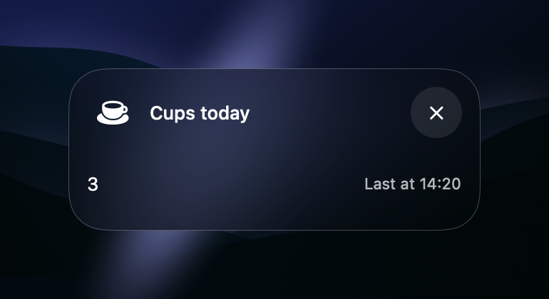
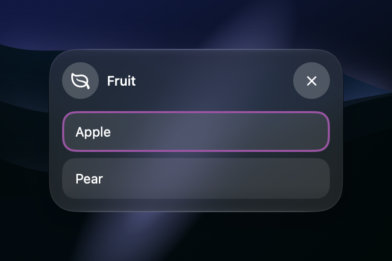
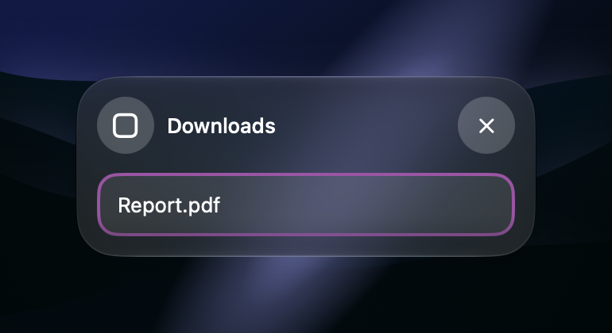
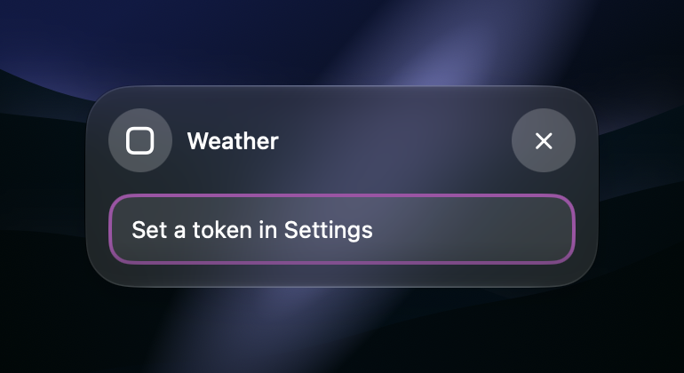
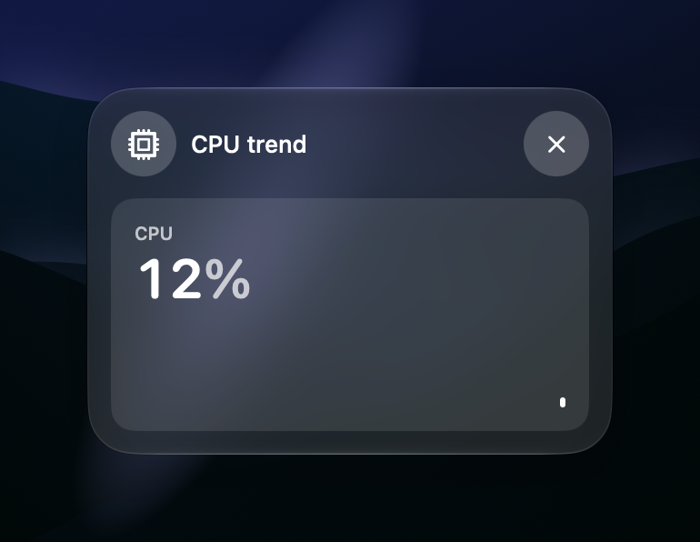
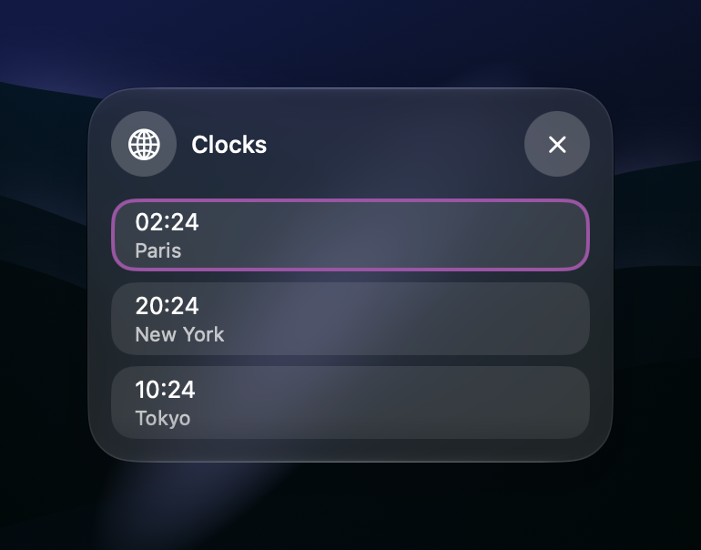
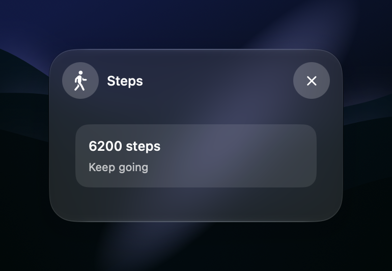

# Openspot guide

In this guide, you build spots, the small programs that Openspot shows in its panel. You start with a spot that lists
the ports in use on your Mac and stops the one you press, then add one thing in each task. The [protocol](PROTOCOL.md)
holds every rule, and [Use Openspot](USING.md) says what the person who uses your spot chooses.

## Build your first spot

Build a spot when you want a small tool one key away. This one lists each process that listens on a port, with its
first port, and stops the one you press, such as a server that's still on :3000.

A spot is a folder in the spots folder, `~/.config/openspot/spots`. Make the folder `ports.spot`, and save its manifest,
the file that names the spot, as `ports.spot/spot.toml`:

```toml
title = "Ports"
icon = "network"
```

Save its script beside it, named like the folder, as `ports.spot/ports.sh`:

```sh
#!/bin/sh
. "$OPENSPOT_SH"
case "$1" in
  show)
    lsof -nP -iTCP -sTCP:LISTEN | awk 'NR > 1 && !seen[$2]++ {
      sub(/.*:/, ":", $9)
      print $2 "\t" $9 "\t" $1
    }' | openspot_items
    ;;
  press) kill "$(value item)" ;;
esac
```

<!-- draw: lsof() { printf 'COMMAND PID USER FD TYPE DEVICE SIZE NODE NAME\nnode 4120 me 21u IPv4 0x1 0t0 TCP *:3000 (LISTEN)\npostgres 812 me 7u IPv4 0x2 0t0 TCP 127.0.0.1:5432 (LISTEN)\npython3 5051 me 3u IPv6 0x3 0t0 TCP *:8080 (LISTEN)\n'; }; . "$EXAMPLE" -->

The sheet of Ports lists a row for each process that listens, with its port as the title and its name under it, such
as :3000 with node.

1. Run `chmod +x ports.sh` in the spot folder. Openspot loads the spot a moment later, and its card shows in the panel.
2. Press `⌃Space`, then press the Ports card. Its sheet opens with a row for each port.
3. Press Return on a row. Openspot runs `ports.sh press` with the row's id, the process ID, as `input.item=` on stdin,
   the process stops, and the panel closes.

Each run of your script is a call. Its first argument names the handler, the part of your script that answers: `show`
asks what to show, and `press` says that the person pressed a row. The shell helper, which `. "$OPENSPOT_SH"` loads,
gives you `value item`, the id of the pressed row, and `openspot_items`, which turns each line of id, title and detail,
split by tabs, into an item block with its values escaped.

A show answers with a frame, the lines that say what to show. Each group of lines is a block, and `item=4120` starts an
item block, a row of the list with the id 4120:

```text
item=4120
title=:3000
detail=node

item=812
title=:5432
detail=postgres
```

Learn more in [A spot](PROTOCOL.md#a-spot), [The calls](PROTOCOL.md#the-calls) and [Items](PROTOCOL.md#items).

## Try your spot

Try a spot while you write it, to see each call and what it printed.

```sh
openspot playground open ports.spot/ports.sh
```

The Playground opens the spot in a panel of its own. Under it, each call shows with its arguments, its stdin, what it
printed, its stderr and how it ended.

1. Change a line of `ports.sh` and save it. The Playground runs the spot again.
2. Run `openspot spot run ports show`. It prints the frame of a show, the way Openspot calls it:

   ```text
   item=4120
   title=:3000
   detail=node
   ```

3. Run `openspot check spots ~/.config/openspot/spots`. It prints nothing when each spot loads and runs, or a `fault`
   block for each error.
4. Run `openspot spot log ports`. It prints the last calls of the spot, with their stdin, stdout, stderr and exit code.

Learn more in [The openspot commands](app/Help/commands.md), which lists the other commands that try a spot, such as
`openspot spot new` and `openspot render spot`.

## Show a value on a card

Show a value on a card when the person wants to see it at a glance, such as the free space of the disk.

`disk.spot/spot.toml`:

```toml
title = "Disk"
icon = "internaldrive"

[on]
"panel.open" = true
every = 300
```

`disk.spot/disk.sh`:

```sh
#!/bin/sh
free=$(df -h / | awk 'NR==2 {print $4}')
printf 'frame=\ndetail=%s free\n\nitem=free\ntitle=%s free\n' "$free" "$free"
```

<!-- card: wide -->
<!-- draw: df() { printf 'Filesystem Size Used Avail\n/dev/disk 994Gi 738Gi 256Gi\n'; }; . "$EXAMPLE" -->


The wide card of Disk shows its icon, the title Disk with 256Gi free under it, and an arrow at its end.

The `[on]` table holds the triggers, the things that call a spot by themselves. `"panel.open" = true` calls `show` each
time the panel opens, and `every = 300` calls `every` every 5 minutes while the card shows. The first block, `frame=`,
is the root, the block of the frame's own keys, which isn't drawn. Its `detail` is the line under the card's title.

1. Add Disk to the grid in Edit Spots, since a spot with `every` starts off the grid. Its card shows the free space.
2. Free some space, and open the panel again. The card shows the new value.

Learn more in [`[on]`](PROTOCOL.md#on), [The root](PROTOCOL.md#the-root) and [The card](PROTOCOL.md#the-card).

## Show a value in the menu bar

Show a value in the menu bar when the person wants to see it all day, beside the clock. A class with `bar:`, the place
of the menu bar, says which block shows there.

`disk.spot/spot.toml`:

```toml
title = "Disk"
icon = "internaldrive"

[on]
"panel.open" = true
every = 300
```

`disk.spot/disk.sh`:

```sh
#!/bin/sh
free=$(df -h / | awk 'NR==2 {print $4}')
printf 'frame=\ndetail=%s free\n\nitem=free\ntitle=%s free\nclass=bar:flex\n' "$free" "$free"
```

1. Press `⌘` Return on the Disk card. Its Settings open.
2. Turn on Show in the menu bar. The menu bar shows the title of the `item` block, such as 256Gi free, next to the clock.
3. Click it. The sheet of Disk opens under it.

Learn more in [The menu bar](PROTOCOL.md#the-menu-bar) and [Variants](PROTOCOL.md#variants).

## Lay out a sheet

Lay out a sheet when a list isn't enough, such as a row of an icon, words and a button. A `box` block holds the blocks
whose `parent` names it, and its classes, the words of Tailwind CSS, say how it lays them out.

`wi-fi.spot/spot.toml`:

```toml
title = "Wi-Fi"
icon = "wifi"
```

`wi-fi.spot/wi-fi.sh`:

```sh
#!/bin/sh
printf 'frame=\nclass=gap-part\n\nbox=head\nclass=flex-row items-center gap-2\n\n'
printf 'icon=wifi\nparent=head\nvalue=wifi\nclass=text-accent\n\n'
printf 'text=name\nparent=head\ntitle=Home\ndetail=82 Mb/s\nclass=grow\n\n'
printf 'button=forget\nparent=head\ntitle=Forget\nclass=rounded-full\n'
```


The sheet shows one row: the Wi-Fi icon in the accent colour, Home with 82 Mb/s under it, and a Forget chip at its end.

1. Remove `class=grow` from the `text` block. The chip moves next to the words, since no block takes the free width.
2. Press Forget. Openspot runs `wi-fi.sh forget`.

Learn more in [Layouts](PROTOCOL.md#layouts), [box](PROTOCOL.md#box) and [Classes](PROTOCOL.md#classes).

## Open an item as a page

Open an item as a page when an item has more to show than a row, such as the detail of a photo. A page is a sheet that a
route names, and the item's `route=` opens it.

`fruit.spot/spot.toml`:

```toml
title = "Fruit"
icon = "leaf"
pages = ["*"]
```

`fruit.spot/fruit.sh`:

```sh
#!/bin/sh
. "$OPENSPOT_SH"
route=$(value route)
case "$route" in
  '') printf 'item=apple\ntitle=Apple\nroute=apple\n\nitem=pear\ntitle=Pear\nroute=pear\n' ;;
  *) openspot_item "$route:color" "Color" "Green" ;;
esac
```


The sheet of Fruit lists two rows, Apple and Pear.

1. Press Return on Apple. Its page opens in place of the list, with one row, Color, and Green under it.
2. Press `⌘[`. The list shows again, and `⌘]` goes forward to the page.
3. Press Esc on the page. The page leaves, so `⌘]` has nothing to go to.

Learn more in [Pages](PROTOCOL.md#pages) and [The message](PROTOCOL.md#the-message).

## Add an action

Add an action when your spot does a thing that the person runs by name, such as moving a window. An action is declared
by a table `[actions.<id>]`, and a run calls the handler of its id.

`windows.spot/spot.toml`:

```toml
title = "Windows"
icon = "macwindow"
uses = ["screen"]

[actions.full]
title = "Full screen"
icon = "rectangle.inset.filled"

[actions.left]
title = "Left side"
icon = "rectangle.lefthalf.inset.filled"
```

`windows.spot/windows.sh`:

```sh
#!/bin/sh
case "$1" in
  full) openspot window move "0 0 1 1" ;;
  left) openspot window move "0 0 1/2 1" ;;
esac
```

1. Type `left` in the panel. The main search lists Left side, with its icon.
2. Press Return on it. Openspot runs `windows.sh left`, and the front window fills the left half of the screen.
3. Press `⌘` Return on the Windows card. Its Settings list a key for each action, which the person records.

A spot whose actions have titles and that has no `[on]` has no sheet, so a press of its card runs its first action.

Learn more in [`[actions.<id>]`](PROTOCOL.md#actionsid) and [The openspot commands](app/Help/commands.md).

## Ask before an action runs

Ask before an action runs when it can't be undone, such as deleting notes. `confirm` holds the words of the question.

`notes.spot/spot.toml`:

```toml
title = "Notes"
icon = "note.text"

[actions.clear]
title = "Clear my notes"
confirm = "Press again to clear your notes"
```

`notes.spot/notes.sh`:

```sh
#!/bin/sh
case "$1" in
  clear) rm -f "$OPENSPOT_DATA/notes" ;;
esac
```

1. Run Clear my notes. Openspot shows Press again to clear your notes, and runs nothing.
2. Press it again. Openspot runs `notes.sh clear`.

`OPENSPOT_DATA` is the data folder of your spot, where it keeps what must last.

Learn more in [`[actions.<id>]`](PROTOCOL.md#actionsid) and [The calls](PROTOCOL.md#the-calls).

## Act on the selected item

Act on the selected item when a row has more than one thing to do, such as moving a note to the Trash. A `button` block
is a verb that the person presses, and a press calls the handler of its id with the selected item.

`notes-list.spot/spot.toml`:

```toml
title = "Notes list"
```

`notes-list.spot/notes-list.sh`:

```sh
#!/bin/sh
. "$OPENSPOT_SH"
case "$1" in
  show)
    openspot_item today Today
    printf '\nbutton=trash\ntitle=Move to Trash\nshortcut=cmd+backspace\nconfirm=Press again to delete\n'
    ;;
  trash) rm -f "$OPENSPOT_DATA/$(value item)" ;;
esac
```


The sheet of Notes list shows one row, Today. The button isn't a row: it's in the ⌘K menu of the selected item.

1. Press `⌘K` on Today. The menu lists Move to Trash, with `⌘⌫` beside it.
2. Press `⌘⌫` twice. Openspot runs `notes-list.sh trash` with `input.item=today` on stdin.

Learn more in [button](PROTOCOL.md#button) and [Items](PROTOCOL.md#items).

## Give an item keys of its own

Give an item keys of its own when an action needs more than its id, such as the path of a file. The action gets each key
as the input `item.<key>`.

`downloads.spot/spot.toml`:

```toml
title = "Downloads"
```

`downloads.spot/downloads.sh`:

```sh
#!/bin/sh
. "$OPENSPOT_SH"
case "$1" in
  show)
    openspot_item report Report.pdf
    openspot_kv path "$HOME/Downloads/Report.pdf"
    printf '\nbutton=reveal\ntitle=Show in Finder\nshortcut=cmd+o\n'
    ;;
  reveal) open -R "$(value item.path)" ;;
esac
```


The sheet of Downloads shows one row, Report.pdf.

1. Press `⌘O` on Report.pdf. Openspot runs `downloads.sh reveal` with `input.item.path=` the path on stdin.
2. Look at Finder. It shows Report.pdf in Downloads.

Learn more in [Items](PROTOCOL.md#items) and [The message](PROTOCOL.md#the-message).

## Ask for values

Ask for values when an action needs words from the person, such as the text of a note. An input is a value that an
action takes, and `required = true` makes Openspot ask for it with a form.

`quick-note.spot/spot.toml`:

```toml
title = "Quick note"

[actions.add]
title = "Add note"
inputs.note = { type = "text", required = true, description = "What to note" }
```

`quick-note.spot/quick-note.sh`:

```sh
#!/bin/sh
. "$OPENSPOT_SH"
case "$1" in
  add)
    printf '%s\n' "$(value note)" >> "$OPENSPOT_DATA/notes"
    openspot toast Saved
    ;;
esac
```

1. Press Return on Quick note. A form opens with one field, Note, and What to note as its hint.
2. Type a note and press Return. Openspot runs `quick-note.sh add` with `input.note=` the note, and a toast says Saved.
3. Press Return on an empty field. The form stays open, since Openspot checks each input before the call.

Learn more in [`[actions.<id>]`](PROTOCOL.md#actionsid), [Forms](PROTOCOL.md#forms) and [Types](PROTOCOL.md#types).

## Run a command with text

Run a command with text when the person types the value with the command, such as `/note buy milk`. A slash command is a
word of `command` in `[on]`.

`notes.spot/spot.toml`:

```toml
title = "Notes"
icon = "note.text"

[on]
command = ["note"]
```

`notes.spot/notes.sh`:

```sh
#!/bin/sh
. "$OPENSPOT_SH"
case "$1" in
  command)
    printf '%s\n' "$(value text)" >> "$OPENSPOT_DATA/notes"
    openspot toast Saved
    ;;
esac
```

1. Type `/note buy milk` in the panel. The row /note is selected.
2. Press Return. Openspot runs `notes.sh command` with `input.name=note` and `input.text=buy milk` on stdin, a toast
   says Saved, and the panel closes.

Learn more in [Slash commands](PROTOCOL.md#slash-commands) and [`[on]`](PROTOCOL.md#on).

## Answer the main search

Answer the main search when your spot knows something about what the person types, such as the sum of `2+2`. `search`
in `[on]` holds the pattern of the texts that your spot answers.

`calculator.spot/spot.toml`:

```toml
title = "Calculator"
icon = "equal.square"

[on]
search = "^[0-9(]"
```

`calculator.spot/calculator.js`:

```js
export default {
  search({ text }) {
    return openspot.call(["calc", "solve", text]).stdout
  },
}
```

<!-- draw: openspot calc solve 2+2 -->

The answer to `2+2` is one row, 4, with 2 + 2 under it.

1. Type `2+2` in the panel. The row 4 shows at the top of the main search in the same keystroke.
2. Type `abc`. The text doesn't match the pattern, so Openspot doesn't call the spot.

A `.js` file with no execute permission runs inside Openspot, which is how it answers in the same keystroke.

Learn more in [The main search](PROTOCOL.md#the-main-search) and [A JavaScript spot](PROTOCOL.md#a-javascript-spot).

## Respond to the Mac

Respond to the Mac when your spot shows something that changes with it, such as the app in front. An event is a change
of the Mac that a key of `[on]` names.

`notes.spot/spot.toml`:

```toml
title = "Notes"

[on]
"sheet.open" = true
"app.front" = "com\\.apple\\.Notes"
```

`notes.spot/notes.sh`:

```sh
#!/bin/sh
printf 'item=n\ntitle=%s\n' "$1"
```

<!-- draw: sh "$EXAMPLE" app.front -->


The sheet of Notes shows one row, app.front, after Notes came to the front.

1. Open the sheet of Notes. It shows show, the handler of the open.
2. Bring Notes to the front while the sheet shows. Openspot runs `notes.sh app.front`, and the row says app.front.

The pattern is a regular expression that the event's value, here the bundle ID of the app, must match.

Learn more in [Events](PROTOCOL.md#events) and [`[on]`](PROTOCOL.md#on).

## Act at a time

Act at a time when your spot does something later, such as a reminder in an hour, even when the panel is closed. A timer
runs an action of your spot at its time.

`stretch.spot/spot.toml`:

```toml
title = "Stretch"
icon = "figure.walk"
uses = ["timer"]

[actions.remind]
inputs.words = { type = "text", required = true }
```

`stretch.spot/stretch.sh`:

```sh
#!/bin/sh
. "$OPENSPOT_SH"
case "$1" in
  show) printf 'button=later\ntitle=Remind me in an hour\nscope=spot\n' ;;
  later) openspot timer add "$(date -u -v+1H +%Y-%m-%dT%H:%M:%SZ)" remind words="Time to stretch" ;;
  remind) openspot toast "$(value words)" ;;
esac
```

1. Open the sheet of Stretch and press `⌘K`. The menu lists Remind me in an hour.
2. Press it. Openspot runs `stretch.sh later`, which adds a timer.
3. Wait an hour. Openspot runs `stretch.sh remind` with `input.words=Time to stretch`, and the toast says Time to stretch.

Learn more in [openspot timer](PROTOCOL.md#openspot-timer) and [`[actions.<id>]`](PROTOCOL.md#actionsid).

## Use another spot

Use another spot when a step of yours is the job of another spot, such as picking a time. A binding names the other
spot, and your spot runs its action and waits for its values.

`remind.spot/spot.toml`:

```toml
title = "Remind me"
icon = "bell"
uses = ["timer"]

[bindings]
picker = { spot = "openspot/snooze" }

[actions.remind]
inputs.words = { type = "text", required = true }
```

`remind.spot/remind.js`:

```js
export default {
  async show(input, env) {
    return [{ button: "later", title: "Remind me later", scope: "spot" }]
  },
  async later(input, env) {
    const picked = await env.picker.pick({ title: "Remind me later" })
    if (picked) await env.timer.add(picked.until, "remind", { words: "Look at this again" })
  },
  async remind({ words }, env) {
    await env.toast(words)
  },
}
```

1. Choose Remind me later in the ⌘K menu. The tiles of Snooze, a spot of Openspot, show over the sheet.
2. Pick Tomorrow. `env.picker.pick` resolves to `{ until: "<the time>" }`, and the spot adds a timer that runs `remind`
   then.
3. Press Esc instead. `env.picker.pick` resolves to `null`, and the spot adds nothing.

`pick` takes an optional `title` and gives one output, `until`: an ISO 8601 time with its offset, or the word
`someday`, which `openspot timer add` takes too. A shell script runs the same action with
`openspot run picker.pick title="Remind me later" --out until`, which prints the time, and exits 4 on Esc, so the
script ends with `|| exit 0` there to show no failure.

Learn more in [`[bindings]`](PROTOCOL.md#bindings) and [openspot run](PROTOCOL.md#openspot-run).

## Tell other spots

Tell other spots when something happens in yours that they may act on, such as the end of a focus session. An event of
your own is declared by a table `[events.<name>]`, and `openspot emit` sends it.

`focus.spot/spot.toml`:

```toml
title = "Focus"
icon = "timer"

[actions.finish]
title = "Finish Focus"

[events.finished]
minutes = { type = "number", required = true }
```

`focus.spot/focus.sh`:

```sh
#!/bin/sh
case "$1" in
  finish) openspot emit finished minutes=25 ;;
esac
```

1. Run Finish Focus. Openspot runs `focus.sh finish`, which sends `finished`.
2. Look at a spot that binds Focus as `focus = { spot = "focus" }` and has `"focus.finished" = true` in its `[on]`.
   Openspot runs its handler `focus.finished` with `input.minutes=25`.

Learn more in [`[events.<name>]`](PROTOCOL.md#eventsname) and [openspot emit](PROTOCOL.md#openspot-emit).

## Keep a setting

Keep a setting when the person makes a choice that lasts, such as a folder. A setting is a key of `[settings]`, and the
spot's Settings list it.

`repos.spot/spot.toml`:

```toml
title = "Repos"

[settings]
folder = { type = "text", title = "Folder" }
```

`repos.spot/repos.sh`:

```sh
#!/bin/sh
. "$OPENSPOT_SH"
case "$1" in
  show)
    folder=$(value setting.folder)
    printf 'item=folder\ntitle=%s\n' "${folder:-Choose a folder in Settings}"
    ;;
  folder)
    picked=$(openspot folder pick)
    [ -n "$picked" ] && openspot setting set folder "$picked"
    ;;
esac
```

<!-- draw: printf 'setting.folder=/Users/me/Code\n' | sh "$EXAMPLE" show -->


Once the person has chosen a folder, the sheet of Repos shows one row, its path, such as /Users/me/Code.

1. Press `⌘` Return on the Repos card. Its Settings list Folder, Not set.
2. Press Return on Folder. Openspot runs `repos.sh folder`, which asks for a folder and keeps it.
3. Open the sheet. Each call now gets `setting.folder=` the path on stdin, and the row shows it.

A setting of type `choice` or `bool` needs no handler, since Openspot shows its options and keeps the one picked.

Learn more in [`[settings]`](PROTOCOL.md#settings) and [Types](PROTOCOL.md#types).

## Keep a secret

Keep a secret when the person gives your spot a value that no other program should see, such as the token of a service.
A setting of type `secret` is kept in the Keychain, and never comes on stdin.

`weather.spot/spot.toml`:

```toml
title = "Weather"

[settings]
token = { type = "secret", title = "Token" }
```

`weather.spot/weather.sh`:

```sh
#!/bin/sh
if [ -n "$(openspot setting get token)" ]; then
  printf 'item=state\ntitle=Signed in\n'
else
  printf 'item=state\ntitle=Set a token in Settings\n'
fi
```


The sheet of Weather shows one row, Set a token in Settings.

1. Press `⌘` Return on the Weather card, and press Return on Token. Openspot asks for it in a form of its own.
2. Type a token of 8 characters or more, and press Return. The sheet now shows Signed in.

Learn more in [`[settings]`](PROTOCOL.md#settings) and [Uses](TRUST.md#uses).

## Keep one process running

Keep one process running when your spot holds something between calls, such as the last points of a chart. A staying
spot, `stay = true`, is one process that gets each call on its stdin.

`cpu-trend.spot/spot.toml`:

```toml
title = "CPU trend"
icon = "cpu"
stay = true

[on]
"sheet.open" = true
"system.load" = true
```

`cpu-trend.spot/cpu-trend.sh`:

```sh
#!/bin/sh
. "$OPENSPOT_SH"
points=
main() {
  load=$(value value)
  case "$load" in
    cpu=*) now=${load#cpu=} && points="$points,${now%% *}" ;;
  esac
  printf 'frame=\nclass=gap-part\n\nseries=cpu\ntitle=CPU\nvalue=%s\nmax=100\nunit=%%\nclass=h-32\n' "${points#,}"
}
openspot_serve main "$@"
```

<!-- draw: printf 'input.value=cpu=12 memory=61\n' | sh "$EXAMPLE" system.load -->

After one reading, the sheet of CPU trend shows a tile with CPU over 12% in big type, and one small bar at its lower right.

1. Open the sheet of CPU trend. Every 5 seconds, Openspot calls `system.load`, and the tile gains a bar.
2. Close the panel, and open the sheet again. The bars are still there, since the same process kept them.

`openspot_serve` runs `main` with the arguments of each call, so the same script also works as a process for each call.

Learn more in [A staying spot](PROTOCOL.md#a-staying-spot), [series](PROTOCOL.md#series) and
[Events](PROTOCOL.md#events).

## Write a spot in JavaScript

Write a spot in JavaScript when it must answer at once, or wait for the person or another spot. A `.js` file with no
execute permission runs inside Openspot, and exports one function for each handler.

`clocks.spot/spot.toml`:

```toml
title = "Clocks"
icon = "globe"
```

`clocks.spot/clocks.js`:

```js
export default {
  async show(input, env) {
    return ["Europe/Paris", "America/New_York", "Asia/Tokyo"].map((zone) => ({
      item: zone,
      title: new Date().toLocaleTimeString("en-GB", { timeZone: zone, hour: "2-digit", minute: "2-digit" }),
      detail: zone.split("/")[1].replace("_", " "),
    }))
  },
}
```


The sheet of Clocks shows three rows, the time in Paris, New York and Tokyo, each with its city under it.

1. Open the sheet of Clocks. Openspot calls `show`, and the array that it returns is the frame, an object for each block.
2. Press Return on Tokyo. Nothing runs, since the spot has no `press` handler.

A handler gets the inputs of the call and `env`, which runs each `openspot` command, such as `env.toast("Copied")`.

Learn more in [A JavaScript spot](PROTOCOL.md#a-javascript-spot).

## Write a spot in Swift

Write a spot in Swift when a shell script does the work badly. Openspot builds the program once, and runs it at each
call.

`cups-today.spot/spot.toml`:

```toml
title = "Cups today"
icon = "cup.and.saucer.fill"
source = ["cups.swift"]
```

`cups-today.spot/cups-today.swift`:

```swift
#!/usr/bin/env swift
print("item=cups\ntitle=\(cups) cups")
```

`cups-today.spot/cups.swift`:

```swift
let cups = 3
```


The sheet of Cups today shows one row, 3 cups.

1. Save the files. Openspot builds the program, with the Command Line Tools, and the first call waits for the build.
2. Change `let cups = 3` to `let cups = 4`. Openspot builds again, and the row says 4 cups.
3. Run `openspot types` in the spot folder. It writes `Openspot.swift`, with a typed method for each handler, which you
   list in `source`.

Learn more in [A Swift spot](PROTOCOL.md#a-swift-spot).

## Draw your own view

Draw your own view when blocks and classes can't give the look you want, such as a chart. A view is a SwiftUI file named
in `views`, and its name is a new kind of block.

`cups-week.spot/spot.toml`:

```toml
title = "Cups this week"
icon = "chart.bar"
views = ["week.swift"]
```

`cups-week.spot/cups-week.sh`:

```sh
#!/bin/sh
printf 'frame=\nclass=gap-part\n\nweek=chart\nvalue=3\nvalue=1\nvalue=2\nclass=h-16\n\nitems=days\n\n'
printf 'item=mon\nparent=days\ntitle=Monday\n\n'
printf 'item=tue\nparent=days\ntitle=Tuesday\n\n'
printf 'item=wed\nparent=days\ntitle=Wednesday\n'
```

`cups-week.spot/week.swift`:

```swift
import SwiftUI

struct SpotView: View {
    let spot: SpotInput

    var body: some View {
        HStack(alignment: .bottom, spacing: 8) {
            ForEach(Array(spot.all("value").enumerated()), id: \.offset) { _, cups in
                RoundedRectangle(cornerRadius: 4)
                    .fill(spot.accent)
                    .frame(width: 28, height: 16 * CGFloat(Int(cups) ?? 0))
            }
            Spacer()
            Image(systemName: "cup.and.saucer.fill")
                .symbolEffect(.pulse, isActive: spot.isShown)
            Button("Done") { spot.close() }
        }
        .padding(spot.inset)
    }
}
```


The sheet of Cups this week shows three bars in the accent colour, a cup and a Done button, over the rows Monday, Tuesday
and Wednesday.

1. Open the sheet. The cup pulses, since `spot.isShown` is true while the view shows.
2. Press Done. `spot.close()` closes the sheet, as Esc does.

`spot.all("value")` gives each `value` line of the block, one bar for each day.

Learn more in [Views](PROTOCOL.md#views).

## Follow the theme in a view

Follow the theme in a view when it should look like the rest of Openspot, and change with the person's theme.
`spot.theme` holds the theme's colours, sizes and fonts.

`walk.spot/spot.toml`:

```toml
title = "Steps"
icon = "figure.walk"
views = ["steps.swift"]
```

`walk.spot/walk.sh`:

```sh
#!/bin/sh
printf 'frame=\nclass=gap-part\n\nsteps=today\nvalue=6200\ngoal=10000\nclass=h-24\n'
```

`walk.spot/steps.swift`:

```swift
import SwiftUI

struct SpotView: View {
    let spot: SpotInput

    var body: some View {
        let theme = spot.theme
        let reached = (Int(spot["value"] ?? "") ?? 0) >= (Int(spot["goal"] ?? "") ?? 1)
        VStack(alignment: .leading, spacing: theme.space.listRowGap) {
            Text("\(spot["value"] ?? "–") steps").font(theme.font.title)
            Text(reached ? "Goal reached" : "Keep going")
                .font(theme.font.detail)
                .foregroundStyle(reached ? theme.color.good : theme.color.ink.opacity(theme.color.secondary))
        }
        .padding(theme.space.padding)
        .frame(maxWidth: .infinity, alignment: .leading)
        .background(theme.color.ink.opacity(theme.color.fill), in: RoundedRectangle(cornerRadius: theme.radius.inner))
        .padding(theme.space.padding)
    }
}
```


The sheet of Steps shows a tile with 6200 steps over Keep going, in the second colour of the words.

1. Change the theme in Themes. The tile takes the new colours, corners and fonts.
2. Change `value=6200` to `value=12000`. The tile says Goal reached, in the colour of `good`.

The box sits `padding` inside the view's place, so its corner is `radius.inner`, and it follows the corner of the card.

Learn more in [Views](PROTOCOL.md#views) and [Change the look of Openspot](USING.md#change-the-look-of-openspot).

## Write a message

Write a toast or a failure line so that the person knows what to do next.

- Instead of `Oops! Something went wrong.`, write `Openspot cannot find a screenshot.`
- Instead of `Error 1: osascript failed.`, write ``Copied, but Openspot cannot paste. Press `⌘V`, or allow Openspot in
  Accessibility.``

Say what happened, and why when you know it. Say what still worked, and the exact step that fixes the rest. Use plain
words, a calm tone, and one or two short sentences. Put each key in backticks.

Learn more in [The life of a call](PROTOCOL.md#the-life-of-a-call) and [The openspot commands](app/Help/commands.md).
