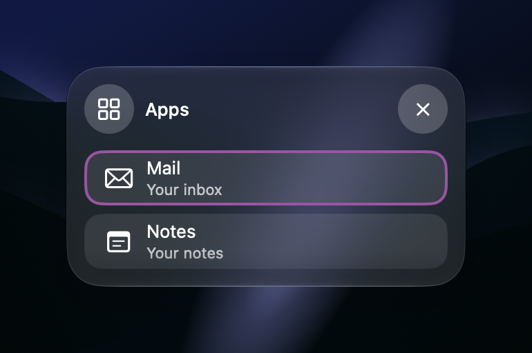
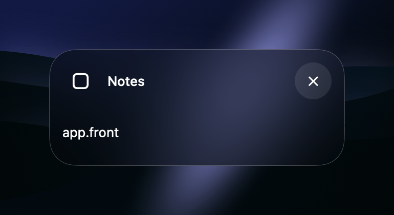
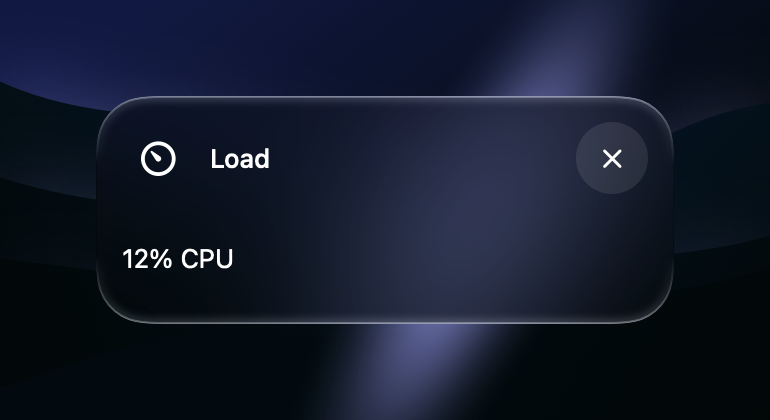
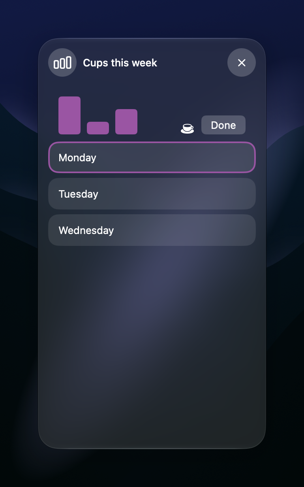

# Openspot guide

Openspot runs small programs called spots. You write a spot in any language. It prints a few lines that say what to
show, and Openspot draws them. When something happens, such as the user opening the spot, Openspot runs it again.

This guide shows how to write one, a task at a time. The [protocol](PROTOCOL.md) gives every rule.

## How it works

Press the Openspot hotkey, and the **panel** opens. It has a search field, and a grid of **cards** under it. Each card is
a spot. Press a card, and its **sheet** opens: a bigger view of that spot, with its text, its controls and its list.

A spot is a folder in the spots folder, such as `cups.spot`, with a script and a `spot.toml` that describes it. Openspot
runs the script when something happens, with the name of what happened, such as `show` or `press`. The spot prints what
to show, and Openspot draws it. The [protocol](PROTOCOL.md) gives every rule of that loop.

## Your first spot

The smallest spot is a folder, such as `morning.spot`, with two files. `spot.toml` is the spot's **manifest**: it gives
the spot a name, an icon and an **action**, a thing the spot can do. `morning.sh` is the script, named after the folder.
Press the spot's card, and Openspot runs the script with the action's id, `morning`.

```toml
title = "Morning"
icon = "sun.max"

[actions.morning]
title = "Open Calendar"
```

```sh
#!/bin/sh
[ "$1" = morning ] || exit 0
open -a Calendar
```

To show something, print it. Openspot runs the spot with `show` each time its sheet opens, and here the spot prints a
title and a detail.

```toml
title = "Cups today"
icon = "cup.and.saucer.fill"
```

```sh
#!/bin/sh
printf 'item=cups\ntitle=3\ndetail=Last at 14:20\n'
```


Each group of lines that the spot prints is a **block**: here, one `item` block, a row with the id `cups`. The sheet
shows **3**, with **Last at 14:20** at the end of the line.

## Try your spot

Try each example of this page in the playground before you put it in the spots folder.

- **Playground.** Open the Playground spot, or run `openspot playground open [file]`. Type a script, or pick a spot from
  Examples, which brings its manifest too. A file runs with the `spot.toml` of its folder. The spot runs in a panel of
  its own: pick its sheet or its card, and type in the panel's search to try its answers. Under
  it, you see each call with its arguments, its stdin, what it printed, its stderr and how it ended. When you open a
  file, edits go straight to the file.
- **New spot.** `openspot spot new <name> --from <kind>` writes a working spot folder, its `spot.toml` and its script,
  that you can change. The kinds are
  `button`, `list`, `number` and `form`.
- **One call.** `openspot spot run <id> [handler] [<name>=<value>]...` runs one handler the way Openspot does, with its
  inputs checked and its bindings live, and prints everything the spot prints. With no handler, it runs `show`. While
  Openspot is open, the script gets the variables of the app, not those of your shell.
- **Actions.** `openspot spot actions <id>` prints each action of the spot, and each command of its uses, with their
  inputs and outputs as JSON Schema.
- **Types.** `openspot schema` prints the JSON Schema of `spot.toml`, which an editor checks the file with.
  `openspot types` writes the types of a JavaScript or Swift spot beside it, so an editor checks its handlers.
- **Image.** `openspot render sheet [--view <file>] <file.png>` draws the sheet that stdin holds.
  `openspot render card <size> <file.png>` draws its card, and `openspot render spot <id> <file.png>` draws an
  installed spot.
- **Log.** `openspot spot log <id>` prints the last calls to a spot, with their stdin, stdout, stderr and exit code.
- **Check.** `openspot check spots [--json] <folder>` loads each spot, runs it once, and prints a `fault` block for each error,
  or nothing. Run it before you share a spot.

## Show a list

A list lets the user search and pick. Print one `item` block for each item. When the user picks an item, Openspot runs
your spot with `press`, and the id of the item as the input `item`.

```toml
title = "Apps"
icon = "square.grid.2x2"
```

```sh
#!/bin/sh
. "$OPENSPOT_SH"
case "$1" in
  show) printf 'Mail\tMail\tYour inbox\tenvelope\nNotes\tNotes\tYour notes\tnote.text\n' | openspot_items ;;
  press) open -a "$(value item)" ;;
esac
```



The sheet shows two items, **Mail** and **Notes**. Type in the sheet's search field, and Openspot filters the items for
you. Pick **Notes**, and Openspot runs `apps.sh press` with `input.item=Notes` on stdin.

The first argument names the **handler**, what your spot should do. `show` asks what to show. Any other name is
something the user did, and its values come on stdin as `input.<name>=`. The shell helper, `$OPENSPOT_SH`, reads them
with `value <name>`, prints items for you and escapes each value.

When your spot has an act that adds to the list, such as Snooze Current Tab or New snippet, make it the first item and
add `pin=top`, so it stays on top while the user types. An act on the selected item, such as Remove, stays a button;
see [Add actions](#add-actions).

Learn more in [Items](PROTOCOL.md#items) and [The calls](PROTOCOL.md#the-calls).

## Open an item as a page

A page shows the detail of an item as a sheet of its own, and keeps the list it came from. Name the pages in the manifest
with `pages`, give the item a `route=` with the page's id, and print the page when `route` holds that id.

```toml
title = "Fruit"
icon = "leaf"
pages = ["*"]
```

```sh
#!/bin/sh
. "$OPENSPOT_SH"
route=$(value route)
case "$route" in
  '') printf 'item=apple\ntitle=Apple\nroute=apple\n\nitem=pear\ntitle=Pear\nroute=pear\n' ;;
  *) openspot_item "$route:color" "Color" "Green" ;;
esac
```

Pick **Apple**, and its page opens in place of the list, with one item, **Color**. Press `⌘[` to go back to the list,
and `⌘]` to go forward to the page again. Esc takes the page off, so `⌘]` has nothing to go to. `⌘Esc` goes back to the grid.

A pick of such an item opens the page at once, with no call to the spot. Each call of a page gets its id as the input
`route`, so a press on the page knows which page it came from. A press can move the flow too: run `openspot route back`
after it saves, and the list shows again.

Learn more in [Pages](PROTOCOL.md#pages).

## Show a value on a card

A card can show one live value, such as free disk space. `"panel.open" = true` in the `[on]` table calls `show` each
time the panel opens, and `every = 300` calls `every` every 5 minutes while the card shows. This spot prints the same
for both.

```toml
title = "Disk"
icon = "internaldrive"

[on]
"panel.open" = true
every = 300
```

```sh
#!/bin/sh
free=$(df -h / | awk 'NR==2 {print $4}')
printf 'frame=\ndetail=%s free\n\nitem=free\ntitle=%s free\n' "$free" "$free"
```

<!-- card: wide -->
<!-- draw: df() { printf 'Filesystem Size Used Avail\n/dev/disk 994Gi 738Gi 256Gi\n'; }; . "$EXAMPLE" -->


The first block, `frame=`, is the **root**: it isn't drawn, and its `detail` becomes the line under the card's title.
The `item` block is the card's **value**, since it's the only one.

The user can also put the spot in the menu bar, next to the clock, from its Settings, which `⌘⏎` on its card opens.
There it shows its icon, until a class of a block names `bar:`, the [variant](PROTOCOL.md#variants) of the menu bar.
Add it to the `item` block, and the menu bar shows its title:

```ini
item=free
title=256Gi free
class=bar:flex
```

A spot with `every` stays off the grid until the user adds it, so that a new spot doesn't fill the panel.

The user also chooses the other places of a spot; see [What the user chooses](#what-the-user-chooses).

Learn more in [The card](PROTOCOL.md#the-card), [Places](PROTOCOL.md#places) and [Events](PROTOCOL.md#events).

## Add actions

An action is a thing your spot can do. Name each one in the manifest with an `[actions.<id>]` table. When the user runs
it, Openspot runs your spot with its id.

An action with a `title` is one the user runs: they find it in the main search and the ⌘K menu, and give it a hotkey in
the spot's Settings. A spot of such actions and no event has no sheet, and Return runs its action.

```toml
title = "Windows"
icon = "macwindow"
uses = ["screen"]

[actions.full]
title = "Full screen"
icon = "rectangle.inset.filled"

[actions.left]
title = "Left side"
icon = "rectangle.lefthalf.inset.filled"
```

```sh
#!/bin/sh
case "$1" in
  full) openspot window move "0 0 1 1" ;;
  left) openspot window move "0 0 1/2 1" ;;
esac
```

Add `confirm` to an action that can't be undone. The first press shows its words, and the second runs
the action. Its hotkey asks the same way.

```toml
title = "Notes"
icon = "note.text"

[actions.clear]
title = "Clear my notes"
confirm = "Press again to clear your notes"
```

```sh
#!/bin/sh
case "$1" in
  clear) rm -f "$OPENSPOT_DATA/notes" ;;
esac
```

A button that the spot prints runs the action that its id names, on the selected item. If no layout places it, it
shows in the ⌘K menu of the sheet, and its shortcut works while an item is selected. The action gets the item's id as
the input `item`. It needs no `[actions.<id>]` table, unless you want to type its inputs. A press that answers with no
view closes the panel; `close=false` keeps it open.

```toml
title = "Notes list"
```

```sh
#!/bin/sh
. "$OPENSPOT_SH"
case "$1" in
  show)
    openspot_item today Today
    printf '\nbutton=trash\ntitle=Move to Trash\nshortcut=cmd+backspace\nconfirm=Press again to delete\n'
    ;;
  trash) rm -f "$OPENSPOT_DATA/$(value item)" ;;
esac
```


Select **Today** and press ⌘⌫ twice, and Openspot runs `notes-list.sh trash` with `input.item=today`.

An item can hold keys of its own, such as `path=`. An action on that item gets each of its keys as an input, such as
`item.path`, so the spot doesn't look the item up again.

```toml
title = "Downloads"
```

```sh
#!/bin/sh
. "$OPENSPOT_SH"
case "$1" in
  show)
    openspot_item report Report.pdf
    openspot_kv path "$HOME/Downloads/Report.pdf"
    printf '\nbutton=reveal\ntitle=Show in Finder\nshortcut=cmd+o\n'
    ;;
  reveal) open -R "$(value item.path)" ;;
esac
```

Select **Report.pdf** and press ⌘O, and `value item.path` prints the path that the item holds.

Learn more in [Actions](PROTOCOL.md#actions) and [Buttons and actions](PROTOCOL.md#buttons-and-actions).

## Lay out a sheet

A layout puts blocks side by side, in a grid or over each other. Put a block inside a `box` with `parent`, and give the
box classes, the words of Tailwind CSS, such as `flex-row` for a row.

```toml
title = "Wi-Fi"
icon = "wifi"
```

```sh
#!/bin/sh
printf 'frame=\nclass=gap-part\n\nbox=head\nclass=flex-row items-center gap-2\n\n'
printf 'icon=wifi\nparent=head\nvalue=wifi\nclass=text-accent\n\n'
printf 'text=name\nparent=head\ntitle=Home\ndetail=82 Mb/s\nclass=grow\n\n'
printf 'button=forget\nparent=head\ntitle=Forget\nclass=rounded-full\n'
```

The sheet shows one row: the Wi-Fi icon in the accent colour, **Home** with **82 Mb/s** under it, and a **Forget** chip
at the end. `rounded-full` makes the button a chip as wide as its words, and `grow` gives the free width to the words, so
the chip sits at the edge. Press **Forget**, and Openspot runs `wi-fi.sh forget`.

A class can name a place or a state before it, such as `card:hidden` or `hover:bg-tile`, and then it applies only
there. One frame draws the sheet and each card that way.

Learn more in [Layouts](PROTOCOL.md#layouts), [Classes](PROTOCOL.md#classes) and [Variants](PROTOCOL.md#variants).

## Ask for values

An action can take values, its **inputs**, each with a type. Mark one `required`, and Openspot asks the user for it with
a form before the action runs.

```toml
title = "Quick note"

[actions.add]
title = "Add note"
inputs.note = { type = "text", required = true, description = "What to note" }
```

```sh
#!/bin/sh
. "$OPENSPOT_SH"
case "$1" in
  add)
    printf '%s\n' "$(value note)" >> "$OPENSPOT_DATA/notes"
    openspot toast Saved
    ;;
esac
```

Press Return on **Quick note**, and a form with one field, **Note**, opens, with **What to note** as its hint. Type a
note and press Return. Openspot runs `quick-note.sh add` with `input.note=` the note, the spot saves it, and a toast
says **Saved**. The spot never sees an empty note, since Openspot checks each input before the call.

An input that isn't required can have a `default`, which the call gets when the user gives none. To refuse a value,
print `error=` and the reason, and the form stays open with it.

Learn more in [Ask for values](PROTOCOL.md#ask-for-values) and [Types](PROTOCOL.md#types).

## Run a command with text

A slash command runs a spot with text that the user types after its word, in one Return. Name the words in `command`
of `[on]`, and read the text with `value text`.

```toml
title = "Notes"
icon = "note.text"

[on]
command = ["note"]
```

```sh
#!/bin/sh
. "$OPENSPOT_SH"
case "$1" in
  command)
    printf '%s\n' "$(value text)" >> "$OPENSPOT_DATA/notes"
    openspot toast Saved
    ;;
esac
```

Type `/note buy milk`. The row **/note** is highlighted. Press Return, and Openspot runs `notes.sh command` with
`input.name=note` and `input.text=buy milk` on stdin. The spot saves the note, and the panel closes. When the spot
prints a frame instead, such as a form, it opens.

The user can rename the word or remove it; see [The places of a spot](#the-places-of-a-spot). The spot still gets its
own word as `name`.

Learn more in [Slash commands](PROTOCOL.md#slash-commands).

## Answer the main search

A spot can answer what the user types in the main search, like a calculator. Add `search` with a pattern to `[on]`.
When the text matches, Openspot runs the spot's `search` handler right away and shows its answer first.

```toml
title = "Calculator"
icon = "equal.square"

[on]
search = "^[0-9(]"
```

```js
export default {
  async search({ text }, env) {
    return env.calc.solve(text)
  },
}
```

<!-- draw: openspot calc solve 2+2 -->


Type `2+2`, and the answer shows at the top of the main search. A `.js` file runs inside Openspot, so it answers in the
same keystroke. It exports one `async` function for each handler, which gets the inputs, here `text`, and `env`, which
runs each `openspot` command, such as `env.calc.solve`. What it returns is the frame.

`search = true` lists the spot's own items in the main search instead, as its `show` prints them.

Learn more in [The main search](PROTOCOL.md#the-main-search) and [A JavaScript spot](PROTOCOL.md#a-javascript-spot).

## Respond to the Mac

Events let a spot update when something happens on the Mac, such as another app coming to the front. Name each one in
`[on]`. A pattern in place of `true` narrows it down.

```toml
title = "Notes"

[on]
"sheet.open" = true
"app.front" = "com\\.apple\\.Notes"
```

```sh
#!/bin/sh
printf 'item=n\ntitle=%s\n' "$1"
```

<!-- draw: sh "$EXAMPLE" app.front -->


Bring Notes to the front while the sheet shows, and Openspot runs the spot's `app.front` handler. The first argument
says why: `show` or `app.front`. An event's handler is a read, so its frame shows as the sheet, as a show's does.

Some events bring a value. `system.load` comes every 5 seconds while the sheet shows, with the load of the Mac as the
input `value`, so the spot starts no tool to measure it.

```toml
title = "Load"
icon = "gauge.with.needle"

[on]
"sheet.open" = true
"system.load" = true
```

```sh
#!/bin/sh
. "$OPENSPOT_SH"
load=$(value value)
case "$load" in
  cpu=*)
    cpu=${load#cpu=}
    printf 'item=cpu\ntitle=%s%% CPU\n' "${cpu%% *}"
    ;;
  *) printf 'item=cpu\ntitle=Measuring…\n' ;;
esac
```

<!-- draw: printf 'input.value=cpu=12 memory=61\n' | sh "$EXAMPLE" system.load -->


The sheet opens with **Measuring…**, and shows the first value within 5 seconds.
`power.change`, `disk.mount` and `device.connect` tell a spot of a new power source, a disk and a USB device the same
way.

Learn more in [Events](PROTOCOL.md#events).

## Use another spot

A spot can hand a step to another spot and wait for what it gives back, such as a time the user picks. Name the other
spot in `[bindings]`, and run its action. Here Snooze, a spot of Openspot, picks the time of a reminder.

```toml
title = "Remind me"
icon = "bell"
uses = ["timer"]

[bindings]
picker = { spot = "openspot/snooze" }

[actions.remind]
inputs.words = { type = "text", required = true }
```

```js
export default {
  async show(input, env) {
    return [{ button: "later", title: "Remind me later", scope: "spot" }]
  },
  async later(input, env) {
    const picked = await env.picker.pick({ title: "Remind me later" })
    if (picked) await env.timer.add(picked.until, "remind", { words: "Look at this again" })
  },
  async remind({ words }, env) {
    await env.toast(words)
  },
}
```

Choose **Remind me later** in the ⌘K menu, and the tiles of Snooze show over the sheet. Pick **Tomorrow**, and
`env.picker.pick` gives its time as `until`, and the spot adds a timer that runs `remind` then. Press Esc instead, and
it gives `null`. The `await` costs no time of the spot's limit, however long the user takes. A shell script runs the
same action with `openspot run picker.pick --out until`.

Learn more in [Use another spot](PROTOCOL.md#use-another-spot) and [Act at a time](PROTOCOL.md#act-at-a-time).

## Let the user choose a setting

A setting keeps a choice of the user, such as a folder. Name it in the `[settings]` table of the manifest, with its
type, and the spot's Settings list it. The user opens them with `⌘⏎` on the spot's card, or with **Settings** in its ⌘K
menu.

```toml
title = "Repos"

[settings]
folder = { type = "text", title = "Folder" }
```

```sh
#!/bin/sh
. "$OPENSPOT_SH"
case "$1" in
  show)
    folder=$(value setting.folder)
    printf 'item=folder\ntitle=%s\n' "${folder:-Choose a folder in Settings}"
    ;;
  folder)
    picked=$(openspot folder pick)
    [ -n "$picked" ] && openspot setting set folder "$picked"
    ;;
esac
```

<!-- draw: printf 'setting.folder=/Users/me/Code\n' | sh "$EXAMPLE" show -->


In the Settings of Repos, choose **Folder**, and Openspot runs `repos.sh folder`. The spot asks for a folder and keeps it.
Each later call gets it on stdin as `setting.folder=`, so the spot reads its setting with no `openspot` call. A setting
of type `choice` or `bool` needs no handler: Openspot shows its options and keeps the one the user picks.

A setting of type `secret` keeps a value that no other program should see, such as the token of a service. Openspot
asks for it in a form of its own and keeps it in the Keychain. It never comes on stdin, so the spot reads it with
`openspot setting get`. A secret has 8 characters or more.

```toml
title = "Weather"

[settings]
token = { type = "secret", title = "Token" }
```

```sh
#!/bin/sh
if [ -n "$(openspot setting get token)" ]; then
  printf 'item=state\ntitle=Signed in\n'
else
  printf 'item=state\ntitle=Set a token in Settings\n'
fi
```

Learn more in [Settings](PROTOCOL.md#settings).

## Write a spot in Swift

A spot can be a Swift program, for work that a shell script does badly. Openspot builds it once, and runs the built
program at each call. Each item of `source` names one more Swift file, or a folder of them, to build with it.

```toml
title = "Cups today"
icon = "cup.and.saucer.fill"
source = ["cups.swift"]
```

```swift
#!/usr/bin/env swift
print("item=cups\ntitle=\(cups) cups")
```

```swift
let cups = 3
```


The first file is the spot, and its code runs first. `cups.swift` sits next to it. The
first call waits for the build, which needs the Command Line Tools. A spot that you share carries its built program, so
the Mac that gets it needs no tools.

The handler's name is `CommandLine.arguments[1]`, and its values come on stdin, as in a script. For typed handlers, run
`openspot types` in the spot folder. It writes `Openspot.swift`, with a `Handlers` protocol, a type for the inputs and
outputs of each handler, and an `Env` that runs each `openspot` command. List it in `source`:

```toml
title = "Stretch"
icon = "figure.walk"
uses = ["timer"]
source = ["Openspot.swift"]

[actions.later]
title = "Remind me in an hour"

[actions.remind]
```

```text
#!/usr/bin/env swift
import Foundation

struct Stretch: Handlers {
    func later(_ input: LaterInput, _ env: Env) async throws -> Answer<NoOutputs> {
        _ = try await env.timer.add(Date().addingTimeInterval(3600).ISO8601Format(), "remind")
        return .none
    }

    func remind(_ input: RemindInput, _ env: Env) async throws -> Answer<NoOutputs> {
        _ = try await env.toast(["Time to stretch."])
        return .none
    }
}

await Openspot.serve(Stretch())
```

Run **Remind me in an hour**, and the spot adds a timer that runs `remind` an hour later. `Openspot.serve` reads the
call, runs the handler of its name, and prints its answer. Each command of `env` starts `openspot` with `posix_spawn`,
which keeps the link that tells Openspot which spot calls, as Foundation's `Process` does not.

Learn more in [A Swift spot](PROTOCOL.md#a-swift-spot).

## Draw your own view

A view draws what blocks can't. Name a SwiftUI file in `views` in the manifest, and the file's name becomes a kind of
block: `week.swift` draws each `week` block. The view reads the keys of its block.

```toml
title = "Cups this week"
icon = "chart.bar"
views = ["week.swift"]
```

```sh
#!/bin/sh
printf 'frame=\nclass=gap-part\n\nweek=chart\nvalue=3\nvalue=1\nvalue=2\nclass=h-16\n\nitems=days\n\n'
printf 'item=mon\nparent=days\ntitle=Monday\n\n'
printf 'item=tue\nparent=days\ntitle=Tuesday\n\n'
printf 'item=wed\nparent=days\ntitle=Wednesday\n'
```

```swift
import SwiftUI

struct SpotView: View {
    let spot: SpotInput

    var body: some View {
        HStack(alignment: .bottom, spacing: 8) {
            ForEach(Array(spot.all("value").enumerated()), id: \.offset) { _, cups in
                RoundedRectangle(cornerRadius: 4)
                    .fill(spot.accent)
                    .frame(width: 28, height: 16 * CGFloat(Int(cups) ?? 0))
            }
            Spacer()
            Image(systemName: "cup.and.saucer.fill")
                .symbolEffect(.pulse, isActive: spot.isShown)
            Button("Done") { spot.close() }
        }
        .padding(spot.inset)
    }
}
```



`spot.all("value")` gives each `value` line of the block, one bar for each day. The view is 16 steps tall, by `h-16`, and the
items fill the sheet under it. `spot.isShown` is false while the panel is hidden: stop a motion or a timer then, as the
cup stops its pulse. `spot.close()` closes the sheet, as Esc does.

Learn more in [Views](PROTOCOL.md#views).

## Follow the theme in a view

A view that takes its colours, sizes and fonts from `spot.theme` looks like the rest of Openspot, and changes with it when
you [change the look](#change-the-look-of-openspot).

```toml
title = "Steps"
icon = "figure.walk"
views = ["steps.swift"]
```

```sh
#!/bin/sh
printf 'frame=\nclass=gap-part\n\nsteps=today\nvalue=6200\ngoal=10000\nclass=h-24\n'
```

```swift
import SwiftUI

struct SpotView: View {
    let spot: SpotInput

    var body: some View {
        let theme = spot.theme
        let reached = (Int(spot["value"] ?? "") ?? 0) >= (Int(spot["goal"] ?? "") ?? 1)
        VStack(alignment: .leading, spacing: theme.space.listRowGap) {
            Text("\(spot["value"] ?? "–") steps").font(theme.font.title)
            Text(reached ? "Goal reached" : "Keep going")
                .font(theme.font.detail)
                .foregroundStyle(reached ? theme.color.good : theme.color.ink.opacity(theme.color.secondary))
        }
        .padding(theme.space.padding)
        .frame(maxWidth: .infinity, alignment: .leading)
        .background(theme.color.ink.opacity(theme.color.fill), in: RoundedRectangle(cornerRadius: theme.radius.inner))
        .padding(theme.space.padding)
    }
}
```

The box sits `padding` inside the view's place, so its corner is `radius.inner`, and it follows the corner of the card.
`spot.theme` gives the values of the theme in five groups. Each colour and strength is the one of the appearance that
shows.

| Member              | Gives                                                                                                  |
| ------------------- | ------------------------------------------------------------------------------------------------------ |
| `spot.theme.color`  | The colours `ink`, `solid`, `onSolid`, `accent`, `good`, `warn` and `bad`, and the strengths `secondary`, `fill`, `selected` and `track`. |
| `spot.theme.space`  | `padding`, `columnGap`, `rowGap`, `listRow`, `listRowGap`, `glyph`, `cell`, the side of a grid cell, and `gridWidth`. |
| `spot.theme.radius` | `card`, `media`, and `inner`, the corner of a part that sits `padding` inside the card or the sheet. |
| `spot.theme.font`   | The fonts `title`, `body`, `detail` and `input`.                                                       |
| `spot.theme.motion` | `press`, the time of a press in seconds, and `pressBounce`, its bounce.                                |

## What the user chooses

A spot says what it has, and the user decides where it shows and which keys reach it. Write a spot for any place and
any key, since Openspot gives each one the same acts.

### The keys of a spot

Every spot answers the same keys, so a user learns them once. Openspot gives each key its act.

| Key          | What it does                                                                                              |
| ------------ | --------------------------------------------------------------------------------------------------------- |
| Return       | The main act of the spot: it runs the spot's one action with a title, or opens its sheet.                 |
| `⌘` Return   | Opens the spot's Settings: its keys, each setting and its places.                                         |
| `⌘Y`         | Opens the items of a spot whose Return runs its action, as its **History**.                               |
| `⌘K`         | Opens the menu of all acts, when it holds more than the footer shows.                                     |

- A spot with one action with a title in its manifest, such as Dictate, runs that action on Return, even before it has
  a hotkey.
  Its items are its History, on `⌘Y` and in its ⌘K menu. Any other spot opens its sheet on Return.
- A press of its card, its open hotkey, a click of it in the menu bar and its slash command with no text do what Return
  does. The click in the menu bar opens the sheet under the menu bar item. A press with `⌘` opens its Settings.
- The ⌘K menu of a card starts with the acts that Openspot adds, always in this order: first what the user does with
  the spot, the main act on Return, History and Share; then what changes it, Settings, Edit and Change Icon; then Turn
  off or a red Delete. The acts that Openspot's own spots offer to every card follow, under the name of their spot. A
  spot adds no act to its own card. Its sheet carries what it does.
- A card's `⌘` keys work while a search is typed, except the ones that edit the words, such as `⌘⌫`.
- Edit copies a prompt that sends an agent to the spot's file. A user changes a spot there, not in its Settings.
- A card shows an arrow when Return opens its sheet, and none when Return runs its action. The footer names the
  spot's own keys first and `⌘K Actions` last.

### The Settings of a spot

Each spot has its own Settings, a sheet that grows from its card, apart from the spot's own sheet.

- They list each thing the user can change about the spot, in this order: first its keys, **Open**, the hotkey of
  each action with a title, and **Float**; then what the spot itself does, each setting, set or not, and each value
  it keeps that no setting names, such as a look; and last its places, **Show in the menu bar** and **Open in a
  window**, which every spot has.
- Each key row records a key on Return, and `⌘⌫` removes it. Return on a setting that Openspot can't keep by itself, a
  `text`, runs the handler with the same name, which can answer with a form, and `⌘⌫` removes its value.
- A choice that stays, such as a look or a folder, is a setting, not a part of the spot's own sheet.
- The Settings spot of Openspot holds only the settings of the app: its keys, Careful mode, Slow motion, Open at login
  and the `openspot` command. The Themes spot changes its look.
- Openspot keeps these keys for the user, and a setting can't use them: of any spot, `icon`, the picture that Change
  Icon keeps; `enabled` and `menubar`, `true` or `false`; and `open`, `float` and `key.<action>`, a hotkey such as
  `ctrl+option+k`, `shake`, or one modifier alone, such as `option`, which a tap of that key presses. The key of
  `open` does what a press of the spot's card does, from any app. Of the spot `openspot`, which is the app: `login`,
  `link`, `careful` and `slow`, `true` or `false`, and `panel-key` and `fix-key`. `slow` runs each motion of the panel
  ten times slower until the app quits.

### The places of a spot

The user puts any spot on the grid, in the menu bar, in a float or in a window, from its Settings and from Edit
Spots. The manifest names no place, and a spot can't claim a hotkey or a place.

- A float shows the spot in a small window at the pointer, which a hotkey or a shake of the pointer opens, and which
  stays while the user works in other apps. The spot never learns where it shows.
- A window opens the sheet in a normal window, from the card, the main search or `openspot spot open`. The user
  moves, resizes and closes it, and Openspot shows in the Dock while it's open. Esc closes it too, and a view that
  fills it should still give a way out, such as a Done button.
- A spot with `every` or an action with a title starts off the grid, so that a new spot doesn't fill the panel. A spot
  of your spots folder with a `schedule` acts by itself, so it starts off until you press **Get** on it in the Store.
- In the spot's record of `~/.config/openspot/config.toml`, `search = false` keeps it out of the main search and out of
  the list of slash commands, and `commands` renames each word of its `command`, or removes it with `""`. Here `/note`
  becomes `/n`:

```toml
[[spots]]
id = "notes"
search = false
commands = { note = "n" }
```

## Write a message

A toast or a failure line tells the user what happened. Write it so that the user knows what to do next.

| Instead of                    | Write                                                                                  |
| ----------------------------- | -------------------------------------------------------------------------------------- |
| `Oops! Something went wrong.` | `Openspot cannot find a screenshot.`                                                   |
| `Error 1: osascript failed.`  | ``Copied, but Openspot cannot paste. Press `⌘V`, or allow Openspot in Accessibility.`` |

Say what happened, and why when you know it. Say what still worked, and the exact step that fixes the rest. Use plain
words, a calm tone, and one or two short sentences. Put each key in backticks.

## Change the look of Openspot

A theme gives Openspot its colours, glass, sizes, type and motion. Change it to make Openspot look your way.

Open **Themes** in Openspot to see each theme, with the one in use checked. Return uses a theme. Its ⌘K menu
duplicates, renames, moves to the Trash or opens the file of a theme, and **Copy prompt** hands a theme to your agent:
describe the look you want, and `⌘⏎` copies a prompt that changes the theme's file. The same prompt comes from
`openspot prompt theme <name> [words]...`.

Each theme lives in one file, `theme.toml`. Run `openspot theme open`, which opens the file of the theme in use, and the
first time makes a copy of `Openspot`, `Openspot copy`, and uses it. A theme names a few colours and choices, and
Openspot works out every other value from them. This one gives Openspot the look of Dracula:

```toml
[dark]
background = "#282A36"
ink = "#F8F8F2"
accent = "#BD93F9"
highlight = "#FF79C6"

[light]
background = "#FFFBEB"
ink = "#1F1F1F"
accent = "#644AC9"
highlight = "#A3144D"

[look]
glass = "regular"
backdrop = "tint"
corner = 20
```

Then draw Openspot with it:

```sh
openspot theme reload
```

`[dark]` and `[light]` each hold the colours of one appearance of the Mac, and `[look]` holds the choices of both:

| Key          | Section             | Means                                                                                         | `Openspot`             |
| ------------ | ------------------- | --------------------------------------------------------------------------------------------- | ---------------------- |
| `background` | `[dark]`, `[light]` | The colour of the panel: it tints the glass, the backdrop and the windows.                    | `#000000`, `#FFFFFF`   |
| `ink`        | `[dark]`, `[light]` | The colour of text and glyphs.                                                                | `#FFFFFF`, `#1C1C1C`   |
| `accent`     | `[dark]`, `[light]` | The colour of a selection, its ring and each chosen state.                                    | `accent`               |
| `highlight`  | `[dark]`, `[light]` | The colour of the search field, the keys, the sliders and a filled card.                      | the `ink`              |
| `good`, `warn`, `bad` | `[dark]`, `[light]` | The colours of a value that is fine, needs a look, or failed. `bad` also marks a press that deletes. | `green`, `orange`, `red` |
| `glass`      | `[look]`            | `clear` shows what is behind the panel. `regular` frosts it, and the `background` tints it strongly. | `regular`       |
| `backdrop`   | `[look]`            | `blur` blurs what is behind the panel. `tint` lays the `background` over it.                  | `blur`                 |
| `reach`      | `[look]`            | `tiles` lays the backdrop as a soft halo around the tiles. `screen` covers the screen.         | `tiles`                |
| `corner`     | `[look]`            | The corner of a card in points. Every other corner follows it.                                | `26`                   |
| `density`    | `[look]`            | A factor on every gap and padding: `0.5` is tight, `1.5` is roomy.                            | `1`                    |
| `type`       | `[look]`            | The size of the text in points. Smaller and larger text follows it.                           | `13`                   |
| `speed`      | `[look]`            | A factor on the speed of every motion: `2` is twice as fast.                                  | `1`                    |

- A key that a theme lacks keeps the value of `Openspot`, so a theme needs only the keys you change.
- A colour is `#RRGGBB`, `#RRGGBBAA`, or a colour of the Mac: `accent`, `green`, `orange` or `red`.
- Openspot works out each other value, such as the fill of a card, from these keys. The fills keep the same visible step
  over any `background`, and the second line of a row stays readable over it, at 4.5:1 or more.
- At the `corner` of 26, a card one row high is a capsule; a smaller corner makes it squarer.
- After `openspot theme reload`, colours and the glass change at once. Corners, density, type, speed and the backdrop
  change when the panel next hides.
- `openspot theme reload` fails on a value it can't read, prints a line for each, such as
  `theme.toml: [look] corner is a number of points from 0 to 100, such as 3.`, and keeps the look as it was. At launch,
  such a value keeps the value of `Openspot`, and a toast shows the line. A key that is not in this guide is such a value.

Keep more than one theme to switch between looks. Each theme is a folder, `themes/<name>.theme` in the folder of your
config, named by the folder, with its `theme.toml` inside:

```sh
openspot theme list
openspot theme new
openspot theme use "Openspot copy"
```

`list` prints a block for each theme, the built-in ones first, and marks the one in use:

```text
theme=Openspot
builtin=true

theme=Openspot copy
used=true
```

| Command                                   | Does                                                                                     |
| ----------------------------------------- | ---------------------------------------------------------------------------------------- |
| `openspot theme use <name>`               | Draws Openspot with a theme.                                                             |
| `openspot theme new`                      | Makes `Theme 2`, then `Theme 3`, and uses it. Its file lists each key behind a `#`; remove the `#` to change one. |
| `openspot theme duplicate [name]`         | Copies the theme in use, or the named one, as `<name> copy`, and uses the copy.          |
| `openspot theme rename <name> <new name>` | Renames a theme.                                                                         |
| `openspot theme delete <name>`            | Moves a theme to the Trash. Deleting the one in use switches to `Openspot`.              |
| `openspot theme open [name]`             | Opens the file of the theme in use, or the named one, and copies a built-in theme first.  |

- A theme in use that is gone gives a toast at launch, and Openspot draws with `Openspot`.
- Openspot comes with built-in themes, such as `Openspot`, with frosted glass, `Openspot Liquid`, the same look with clear glass, and `Dracula`. Until you choose one, Openspot uses `Openspot Liquid` on macOS 26 and `Openspot` on a later macOS. A built-in theme can't change, be renamed or be
  deleted: `openspot theme duplicate` makes a copy of it that you can change.
- A name can't be empty, start with `.`, or hold `/` or a new line, and the spaces around it are dropped. A folder that
  has the name of a built-in theme, in any case, is not a theme, and a toast at launch asks you to rename it.
- `openspot theme use` fails on a theme with a value it can't read, prints a line for each, and keeps the theme in use.

### Set a value exactly

Set a value exactly when the value that Openspot works out is not the one you want, such as square windows on a theme
with small corners. Name the value in `[dark]` or `[light]` for a colour or a strength of one appearance, and in
`[advanced]` for a size, a time or the backdrop:

```toml
[dark]
solid = "#FF79C6"
fill = 0.12

[advanced]
window-corner = 6
column-gap = 6
press-bounce = 0
```

| Key                                       | Section             | Sets                                                                                    |
| ----------------------------------------- | ------------------- | --------------------------------------------------------------------------------------- |
| `solid`, `on-solid`, `glyph-on-solid`     | `[dark]`, `[light]` | A filled card, its text and its glyph. They follow `highlight`.                         |
| `glass-tint`, `corner-fill`, `window`     | `[dark]`, `[light]` | The tint of the glass, the fill behind a corner button, and a lifted card and a window. They follow `background`. |
| `confirm`, `on-confirm`                   | `[dark]`, `[light]` | A press that asks again before it deletes, and its text. They follow `bad`.             |
| `backdrop-tint`                           | `[dark]`, `[light]` | The colour of the backdrop `tint`. It follows `background`.                             |
| `card-shadow`                             | `[dark]`, `[light]` | The colour of the soft shadow under each glass surface. Its strength is its alpha.       |
| `fill`, `selected`, `disc`, `chip`, `control`, `track`, `secondary` | `[dark]`, `[light]` | Strengths from 0 to 1 of the `ink`: the field and a card, a chosen row, the disc behind a glyph, a chip, a button, a track and ring, and the second line of a row. |
| `cell`, `glyph`, `list-row`, `menu-row`   | `[advanced]`        | The side of a grid cell, of a glyph, and the height of a row and a menu row, in points. |
| `column-gap`, `row-gap`, `padding`, `list-row-gap`, `menu-padding` | `[advanced]` | The gaps and paddings in points. They follow `density`.                     |
| `window-corner`, `media-corner`, `mark-corner` | `[advanced]`   | The corners of a window, a picture and a corner mark. They follow `corner`.             |
| `title`, `body`, `detail`, `input`        | `[advanced]`        | The sizes of the text in points. They follow `type`.                                    |
| `grow`, `shrink`, `move`, `fade-in`, `fade-out`, `press`, `settle` | `[advanced]` | The time of each motion in seconds. They follow `speed`.                     |
| `press-bounce`, `pressed-scale`, `lifted-scale`, `focused-scale` | `[advanced]` | The bounce of a press, and the scale of a pressed, a lifted and a focused card.   |
| `backdrop-blur`, `halo-size`, `halo-padding` | `[advanced]`     | The strength of the backdrop's blur, how far its halo reaches past the tiles, from 16 to 90, and how far it holds its full strength, from 0 to 74. |
| `card-shadow-size`                        | `[advanced]`     | How far the shadow under each glass surface spreads, in points.                        |

- An exact value holds only in the file that sets it. A copy of `Openspot` keeps the exact values in its file, but a
  theme you write from scratch works out its own.
- A value that follows another follows the exact one too: an exact `solid` gives `on-solid` the colour that reads on it.
