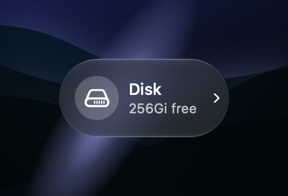
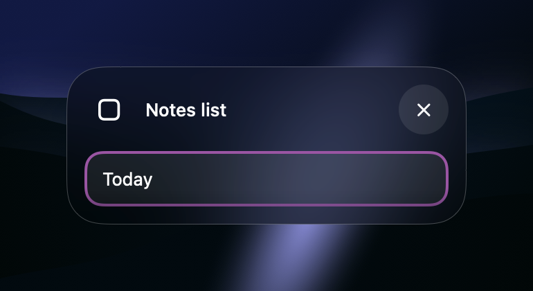
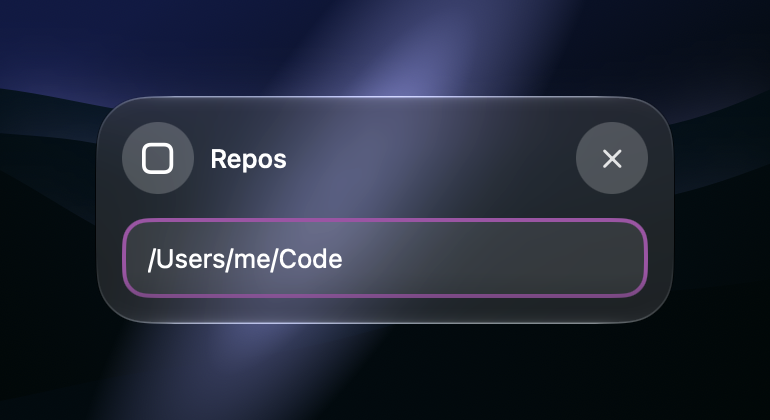

# Openspot guide

Openspot runs small programs called spots. You write a spot in any language. It prints a few lines that say what to
show, and Openspot draws them. When something happens, such as the user opening the spot, Openspot runs it again.

This guide shows how to write one, a task at a time. The [protocol](PROTOCOL.md) gives every rule.

## How it works

Press the Openspot hotkey, and the **panel** opens. It has a search field, and a grid of **cards** under it. Each card is
a spot. Press a card, and its **sheet** opens: a bigger view of that spot, with its text, its controls and its list.

A spot is a folder in the spots folder, such as `cups.spot`, with a script and a `spot.toml` that describes it. Openspot
runs the script when something happens, the spot prints what to show, and Openspot draws it. When the user presses
something, Openspot runs the spot again with the id of what was pressed. The [protocol](PROTOCOL.md) gives every rule of that loop.

## Your first spot

The smallest spot is a folder, such as `morning.spot`, with two files. `spot.toml` is the spot's **manifest**: it gives
the spot a name and an icon. `morning.sh` is the script, named after the folder. Press the spot's card, and the script
runs.

```toml
title = "Morning"
icon = "sun.max"
```

```sh
#!/bin/sh
open -a Calendar
```

To show something, add `on` to the manifest. It lists when Openspot asks the spot what to show. Here, Openspot asks when
the sheet opens, and the spot prints a title and a detail.

```toml
title = "Cups today"
icon = "cup.and.saucer.fill"
on = ["sheet.open"]
```

```sh
#!/bin/sh
printf 'text=cups\ntitle=3\ndetail=Last at 14:20\n'
```


Each group of lines that the spot prints is a **block**: here, one `text` block with the id `cups`. The sheet shows **3**,
with **Last at 14:20** at the end of the line.

## Try your spot

Try each example of this page in the playground before you put it in the spots folder.

- **Playground.** Open the Playground spot, or run `openspot playground open [file]`. Type a script, or pick a spot from
  Examples, which brings its manifest too. A file runs with the `spot.toml` of its folder. The spot runs in a panel of
  its own: pick its sheet or its card, and type in the panel's search to try its answers. Under
  it, you see each call with its arguments, its stdin, what it printed, its stderr and how it ended. When you open a
  file, edits go straight to the file.
- **New spot.** `openspot spot new <name> --from <kind>` writes a working spot folder, its `spot.toml` and its script,
  that you can change. The kinds are
  `button`, `list`, `number` and `form`.
- **One call.** `openspot spot run <id> [call] [value]...` runs one call the way Openspot does, and prints everything the
  spot prints. With no call, it asks the spot what to show. While Openspot is open, the script gets the variables of
  the app, not those of your shell.
- **Image.** `openspot render sheet [--view <file>] <file.png>` draws the sheet that stdin holds.
  `openspot render card <size> <file.png>` draws its card, and `openspot render spot <id> <file.png>` draws an
  installed spot.
- **Log.** `openspot spot log <id>` prints the last calls to a spot, with their stdin, stdout, stderr and exit code.
- **Check.** `openspot check spots [--json] <folder>` loads each spot, runs it once, and prints a `fault` block for each error,
  or nothing. Run it before you share a spot.

## Show a list

A list lets the user search and pick. Print one `row` block for each item. When the user picks a row, Openspot runs your
spot with `open` and the id of the row.

```toml
title = "Apps"
icon = "square.grid.2x2"
on = ["sheet.open"]
```

```sh
#!/bin/sh
. "$OPENSPOT_SH"
case "$1" in
  read) printf 'Mail\tMail\tYour inbox\tenvelope\nNotes\tNotes\tYour notes\tnote.text\n' | openspot_rows ;;
  open) open -a "$2" ;;
esac
```


The sheet shows two rows, **Mail** and **Notes**. Type in the sheet's search field, and Openspot filters the rows for
you. Pick **Notes**, and Openspot runs `apps.sh open Notes`.

The first argument tells your spot what to do. `read` asks what to show. Any other word is something the user did. The
shell helper, `$OPENSPOT_SH`, prints rows for you and escapes each value.

Learn more in [Rows](PROTOCOL.md#rows) and [The calls](PROTOCOL.md#the-calls).

## Open a row as a page

A page shows the detail of a row as a sheet of its own, and keeps the list it came from. Name the pages in the manifest
with `pages`, give the row `push=true`, and print the page when `OPENSPOT_PAGE` holds its id.

```toml
title = "Fruit"
icon = "leaf"
on = ["sheet.open"]
pages = ["*"]
```

```sh
#!/bin/sh
. "$OPENSPOT_SH"
case "$OPENSPOT_PAGE" in
  '') printf 'row=apple\ntitle=Apple\npush=true\n\nrow=pear\ntitle=Pear\npush=true\n' ;;
  *) openspot_row "$OPENSPOT_PAGE:color" "Color" "Green" ;;
esac
```

Pick **Apple**, and its page opens in place of the list, with one row, **Color**. Press `⌘[` to go back to the list,
and `⌘]` to go forward to the page again. Esc takes the page off, so `⌘]` has nothing to go to. `⌘Esc` goes back to the grid.

Each call of a page gets its id in `OPENSPOT_PAGE`, so a press on the page knows which page it came from. A press can
move the flow too: print `pop=true` after it saves, and the list shows again. A row or a press with `push.spot=` pushes
another spot, which reads what to show from its page, as a web page reads its URL.

Learn more in [Pages](PROTOCOL.md#pages).

## Show a value on a card

A card can show one live value, such as free disk space. `panel.open` in `on` asks your spot each time the panel opens,
and `clock.300` asks it again every 5 minutes while the card shows.

```toml
title = "Disk"
icon = "internaldrive"
on = ["panel.open", "clock.300"]
offers = ["card", "menubar"]
```

```sh
#!/bin/sh
free=$(df -h / | awk 'NR==2 {print $4}')
printf 'detail=%s free\n\ntext=free\ntitle=%s free\n' "$free" "$free"
```

<!-- card: wide -->
<!-- draw: df() { printf 'Filesystem Size Used Avail\n/dev/disk 994Gi 738Gi 256Gi\n'; }; . "$EXAMPLE" -->


The first block, `detail=…`, is the **head**: it isn't drawn, and its `detail` becomes the line under the card's title.
The `text` block is the spot's **main block**. `card` and `menubar` in `offers` name the places where the spot can
show it: a card on the grid, and the menu bar, next to the clock. The user puts the spot in the menu bar from its Settings,
which `⌘⏎` on its card opens.

A spot with a clock stays off the grid until the user adds it, so that a new spot doesn't fill the panel.

Learn more in [The main block and the card](PROTOCOL.md#the-main-block-and-the-card) and [Events](PROTOCOL.md#events).

## Add buttons

A button runs a command. Give each button an id. When the user presses it, Openspot runs your spot with that id.

Commands in the manifest turn the spot into a set of commands, with no card. Each one is a `[commands.<id>]` table. The user finds each command in the main
search, and gives it a hotkey in its Settings.

```toml
title = "Windows"
icon = "macwindow"
uses = ["screen"]

[commands.full]
title = "Full screen"
icon = "rectangle.inset.filled"

[commands.left]
title = "Left side"
icon = "rectangle.lefthalf.inset.filled"
```

```sh
#!/bin/sh
case "$1" in
  full) openspot window move "0 0 1 1" ;;
  left) openspot window move "0 0 1/2 1" ;;
esac
```

Add `confirm` to a command that can't be undone. The first press shows its words, and the second runs
the command. Its hotkey asks the same way.

```toml
title = "Notes"
icon = "note.text"

[commands.clear]
title = "Clear my notes"
confirm = "Press again to clear your notes"
```

```sh
#!/bin/sh
case "$1" in
  clear) rm -f "$OPENSPOT_DATA/notes" && echo 'toast=Cleared' ;;
esac
```

A button that the spot prints acts on its rows. If no layout places it, it shows in the ⌘K menu of the sheet, and its
shortcut works while a row is selected.

```toml
title = "Notes list"
on = ["sheet.open"]
```

```sh
#!/bin/sh
. "$OPENSPOT_SH"
case "$1" in
  read)
    openspot_row today Today
    printf '\nbutton=trash\ntitle=Move to Trash\nshortcut=cmd+backspace\nconfirm=Press again to delete\n'
    ;;
  trash) rm -f "$OPENSPOT_DATA/$2" ;;
esac
```



Select **Today** and press ⌘⌫ twice, and Openspot runs `notes-list.sh trash today`.

A row can hold keys of its own, such as `path=`. An action on that row gets each of its keys on stdin, so the spot
doesn't look the row up again.

```toml
title = "Downloads"
on = ["sheet.open"]
```

```sh
#!/bin/sh
. "$OPENSPOT_SH"
case "$1" in
  read)
    openspot_row report Report.pdf
    openspot_kv path "$HOME/Downloads/Report.pdf"
    printf '\nbutton=reveal\ntitle=Show in Finder\nshortcut=cmd+o\n'
    ;;
  reveal) open -R "$(value path)" ;;
esac
```

Select **Report.pdf** and press ⌘O, and `value path` prints the path that the row holds.

Learn more in [Buttons and actions](PROTOCOL.md#buttons-and-actions).

## Ask for values

A button with `form=true` asks the user for values before it runs. Openspot runs it once with empty stdin to get the
form, then again with the values the user typed.

```toml
title = "Quick note"
on = ["sheet.open"]
```

```sh
#!/bin/sh
. "$OPENSPOT_SH"
case "$1" in
  read) printf 'text=hint\ntitle=Press ⌘K to add a note\n\nbutton=add\ntitle=Add note\nform=true\nscope=spot\n' ;;
  add)
    note=$(value note)
    if [ -z "$note" ]; then
      printf 'title=New note\n\nfield=note\ntitle=Note\n'
    else
      printf '%s\n' "$note" >> "$OPENSPOT_DATA/notes"
      openspot_kv toast "Saved"
    fi
    ;;
esac
```

Choose **Add note**, and a form with one field opens. Type a note and press Return. The spot saves it, and a toast says
**Saved**. `value note` reads the field from stdin.

Learn more in [Buttons and actions](PROTOCOL.md#buttons-and-actions) and [The head](PROTOCOL.md#the-head).

## Run a command with text

A slash command runs a spot with text that the user types after its name, in one Return. Read the text with
`value search`, and print a form when you need more.

```toml
title = "Notes"
icon = "note.text"

[commands.add]
title = "Add note"
placeholder = "What to note"
```

```sh
#!/bin/sh
. "$OPENSPOT_SH"
case "$1" in
  add)
    note=$(value note)
    [ -n "$note" ] || note=$(value search)
    if [ -z "$note" ]; then
      printf 'title=New note\n\nfield=note\ntitle=Note\n'
    else
      printf '%s\n' "$note" >> "$OPENSPOT_DATA/notes"
      openspot_kv toast "Saved"
    fi
    ;;
esac
```

Type `/notes`, and the grey hint **What to note** shows after it. Type `buy milk` after it. The row **Add note** is highlighted, and the footer says **⏎ Add note "buy milk"**. Press Return, and Openspot runs
`notes add` with `search=buy milk` on stdin. The spot saves the note, and the panel closes. When the spot prints a form
instead, the form opens, and its values go to the same call.

Learn more in [Slash commands](PROTOCOL.md#slash-commands).

## Answer the main search

A spot can answer what the user types in the main search, like a calculator. Add `search.text` with a pattern to `on`. When
the text matches, Openspot asks your spot right away and shows its answer first.

```toml
title = "Calculator"
icon = "equal.square"
on = ["search.text ^[0-9(]"]
uses = ["clipboard"]
```

```js
function main(args, env) {
  if (args[0] === "read")
    return openspot.call(["calc", "solve", env.OPENSPOT_VALUE]).stdout;
  return "";
}
```

<!-- draw: openspot calc solve 2+2 -->


Type `2+2`, and the answer shows at the top of the main search. `OPENSPOT_VALUE` holds the typed text. A `.js` file runs
inside Openspot, so it answers in the same keystroke.

Learn more in [Places](PROTOCOL.md#places) and [Modes](PROTOCOL.md#modes).

## Respond to the Mac

Events let a spot update when something happens on the Mac, such as another app coming to the front. A filter after the
event narrows it down.

```toml
title = "Notes"
on = ["sheet.open", "app.front com\\.apple\\.Notes"]
```

```sh
#!/bin/sh
printf 'text=n\ntitle=%s\n' "$OPENSPOT_REASON"
```

<!-- draw: OPENSPOT_REASON=app.front sh "$EXAMPLE" -->


Bring Notes to the front while the sheet shows, and Openspot asks the spot again. `OPENSPOT_REASON` says why:
`sheet.open` or `app.front`.

Some events bring a value. `system.load` comes every 5 seconds while the sheet shows, with the load of the Mac in
`OPENSPOT_VALUE`, so the spot starts no tool to measure it.

```toml
title = "Load"
icon = "gauge.with.needle"
on = ["sheet.open", "system.load"]
```

```sh
#!/bin/sh
case "${OPENSPOT_VALUE-}" in
  cpu=*)
    cpu=${OPENSPOT_VALUE#cpu=}
    printf 'text=cpu\ntitle=%s%% CPU\n' "${cpu%% *}"
    ;;
  *) printf 'text=cpu\ntitle=Measuring…\n' ;;
esac
```

<!-- draw: OPENSPOT_VALUE='cpu=12 memory=61' sh "$EXAMPLE" -->


The sheet opens with **Measuring…**, and shows the first value within 5 seconds.
`power.change`, `disk.mount` and `device.connect` tell a spot of a new power source, a disk and a USB device the same
way.

Learn more in [Events](PROTOCOL.md#events).

## Combine spots on one card

One card can show several spots side by side, such as the battery, the CPU and the memory. You write only a manifest,
and Openspot fills the card with the main blocks of the spots that it names.

```toml
title = "System"
"grid.large" = ["battery battery cpu    cpu", "battery battery memory memory"]
to = "system-info"
```

```sh
#!/bin/sh
```

<!-- card: large -->


Each word is the id of another spot. At the large size, the card shows the battery on the left, and the CPU over the
memory on the right. Press the card, and the spot `system-info` opens.

Learn more in [Cards of other spots](PROTOCOL.md#cards-of-other-spots).

## Let the user choose a setting

A setting keeps a choice of the user, such as a folder. Name it in the manifest with a `[settings.<key>]` table,
and the spot's Settings list it. The user opens them with `⌘⏎` on the spot's card, or with **Settings** in its ⌘K menu.

```toml
title = "Repos"
on = ["sheet.open"]

[settings.folder]
```

```sh
#!/bin/sh
case "$1" in
  read) printf 'text=folder\ntitle=%s\n' "${OPENSPOT_SETTING_FOLDER:-Choose a folder in Settings}" ;;
  folder)
    picked=$(openspot folder pick)
    [ -n "$picked" ] && openspot setting set folder "$picked"
    ;;
esac
```

<!-- draw: OPENSPOT_SETTING_FOLDER=/Users/me/Code sh "$EXAMPLE" read -->


In the Settings of Repos, choose **Folder**, and Openspot runs `repos.sh folder`. The spot asks for a folder and keeps it.
Each later call gets it in `OPENSPOT_SETTING_FOLDER`, so the spot reads its setting with no `openspot` call.

A setting with `type = "secret"` keeps a value that no other program should see, such as the token of a service. Openspot
asks for it in a form of its own, keeps it in the Keychain, and gives it to each call only on stdin, as
`setting.token`. A secret has 8 characters or more.

```toml
title = "Weather"
on = ["sheet.open"]

[settings.token]
type = "secret"
```

```sh
#!/bin/sh
. "$OPENSPOT_SH"
if [ -n "$(value setting.token)" ]; then
  printf 'text=state\ntitle=Signed in\n'
else
  printf 'text=state\ntitle=Set a token in Settings\n'
fi
```

Learn more in [Settings](PROTOCOL.md#settings).

## Write a spot in Swift

A spot can be a Swift program, for work that a shell script does badly. Openspot builds it once, and runs the built
program at each call. Each item of `source` names one more Swift file, or a folder of them, to build with it.

```toml
title = "Cups today"
icon = "cup.and.saucer.fill"
on = ["sheet.open"]
source = ["cups.swift"]
```

```swift
#!/usr/bin/env swift
print("text=cups\ntitle=\(cups) cups")
```

```swift
let cups = 3
```


The first file is the spot, and its code runs first. `cups.swift` sits next to it. The
first call waits for the build, which needs the Command Line Tools. A spot that you share carries its built program, so
the Mac that gets it needs no tools.

Learn more in [A Swift spot](PROTOCOL.md#a-swift-spot).

## Draw your own view

A view draws what blocks can't. Name a SwiftUI file with `view` in the manifest, and print a `view` block where
it draws. The view reads the keys of its block, and the rows of the frame.

```toml
title = "Cups this week"
icon = "chart.bar"
on = ["sheet.open"]
view = "week.swift"
```

```sh
#!/bin/sh
printf 'view=week\n\n'
printf 'row=mon\ntitle=Monday\ncups=3\n\n'
printf 'row=tue\ntitle=Tuesday\ncups=1\n\n'
printf 'row=wed\ntitle=Wednesday\ncups=2\n'
```

```swift
import SwiftUI

struct SpotView: View {
    let spot: SpotInput

    var body: some View {
        HStack(alignment: .bottom, spacing: 8) {
            ForEach(spot.rows) { row in
                RoundedRectangle(cornerRadius: 4)
                    .fill(spot.accent)
                    .frame(width: 28, height: 16 * CGFloat(Int(row["cups"] ?? "") ?? 0))
            }
            Spacer()
            Image(systemName: "cup.and.saucer.fill")
                .symbolEffect(.pulse, isActive: spot.isShown)
            Button("Done") { spot.close() }
        }
        .padding(spot.inset)
    }
}
```


`spot.rows` holds each row with its keys, so the bars need no second copy of the data. In a sheet, Openspot draws the
rows under the view. `spot.isShown` is false while the panel is hidden: stop a motion or a timer then, as the cup stops
its pulse. `spot.close()` closes the sheet, as Esc does.

Learn more in [Views](PROTOCOL.md#views).

## Follow the theme in a view

A view that takes its colours, sizes and fonts from `spot.theme` looks like the rest of Openspot, and changes with it when
you [change the look](#change-the-look-of-openspot).

```toml
title = "Steps"
icon = "figure.walk"
on = ["sheet.open"]
view = "steps.swift"
```

```sh
#!/bin/sh
printf 'view=steps\nvalue=6200\ngoal=10000\n'
```

```swift
import SwiftUI

struct SpotView: View {
    let spot: SpotInput

    var body: some View {
        let theme = spot.theme
        let reached = (Int(spot["value"] ?? "") ?? 0) >= (Int(spot["goal"] ?? "") ?? 1)
        VStack(alignment: .leading, spacing: theme.space.listRowGap) {
            Text("\(spot["value"] ?? "–") steps").font(theme.font.title)
            Text(reached ? "Goal reached" : "Keep going")
                .font(theme.font.detail)
                .foregroundStyle(reached ? theme.color.good : theme.color.ink.opacity(theme.color.secondary))
        }
        .padding(theme.space.padding)
        .frame(maxWidth: .infinity, alignment: .leading)
        .background(theme.color.ink.opacity(theme.color.fill), in: RoundedRectangle(cornerRadius: theme.radius.inner))
        .padding(theme.space.padding)
    }
}
```

The box sits `padding` inside the view's place, so its corner is `radius.inner`, and it follows the corner of the card.
[Views](PROTOCOL.md#views) lists each value of `spot.theme`.

## Change the look of Openspot

A theme gives Openspot its colours, glass, sizes, type and motion. Change it to make Openspot look your way.

Open **Themes** in Openspot to see each theme, with the one in use checked. Return uses a theme. Its ⌘K menu
duplicates, renames, moves to the Trash or opens the file of a theme, and **Copy prompt** hands a theme to your agent:
describe the look you want, and `⌘⏎` copies a prompt that changes the theme's file. The same prompt comes from
`openspot prompt theme <name> [words]...`.

Each theme lives in one file, `theme.toml`. Run `openspot theme open`, which opens the file of the theme in use, and the
first time makes a copy of `Openspot`, `Openspot copy`, and uses it. A theme names a few colours and choices, and
Openspot works out every other value from them. This one gives Openspot the look of Dracula:

```toml
[dark]
background = "#282A36"
ink = "#F8F8F2"
accent = "#BD93F9"
highlight = "#FF79C6"

[light]
background = "#FFFBEB"
ink = "#1F1F1F"
accent = "#644AC9"
highlight = "#A3144D"

[look]
glass = "regular"
backdrop = "tint"
corner = 20
```

Then draw Openspot with it:

```sh
openspot theme reload
```

`[dark]` and `[light]` each hold the colours of one appearance of the Mac, and `[look]` holds the choices of both:

| Key          | Section             | Means                                                                                         | `Openspot`             |
| ------------ | ------------------- | --------------------------------------------------------------------------------------------- | ---------------------- |
| `background` | `[dark]`, `[light]` | The colour of the panel: it tints the glass, the backdrop and the windows.                    | `#000000`, `#FFFFFF`   |
| `ink`        | `[dark]`, `[light]` | The colour of text and glyphs.                                                                | `#FFFFFF`, `#1C1C1C`   |
| `accent`     | `[dark]`, `[light]` | The colour of a selection, its ring and each chosen state.                                    | `accent`               |
| `highlight`  | `[dark]`, `[light]` | The colour of the search field, the keys, the sliders and a filled card.                      | the `ink`              |
| `good`, `warn`, `bad` | `[dark]`, `[light]` | The colours of a value that is fine, needs a look, or failed. `bad` also marks a press that deletes. | `green`, `orange`, `red` |
| `glass`      | `[look]`            | `clear` shows what is behind the panel. `regular` frosts it, and the `background` tints it strongly. | `clear`         |
| `backdrop`   | `[look]`            | `blur` blurs what is behind the panel. `tint` lays the `background` over it.                  | `blur`                 |
| `reach`      | `[look]`            | `tiles` lays the backdrop as a soft halo around the tiles. `screen` covers the screen.         | `tiles`                |
| `corner`     | `[look]`            | The corner of a card in points. Every other corner follows it.                                | `26`                   |
| `density`    | `[look]`            | A factor on every gap and padding: `0.5` is tight, `1.5` is roomy.                            | `1`                    |
| `type`       | `[look]`            | The size of the text in points. Smaller and larger text follows it.                           | `13`                   |
| `speed`      | `[look]`            | A factor on the speed of every motion: `2` is twice as fast.                                  | `1`                    |

- A key that a theme lacks keeps the value of `Openspot`, so a theme needs only the keys you change.
- A colour is `#RRGGBB`, `#RRGGBBAA`, or a colour of the Mac: `accent`, `green`, `orange` or `red`.
- Openspot works out each other value, such as the fill of a card, from these keys. The fills keep the same visible step
  over any `background`, and the second line of a row stays readable over it, at 4.5:1 or more.
- At the `corner` of 26, a card one row high is a capsule; a smaller corner makes it squarer.
- After `openspot theme reload`, colours and the glass change at once. Corners, density, type, speed and the backdrop
  change when the panel next hides.
- `openspot theme reload` fails on a value it can't read, prints a line for each, such as
  `theme.toml: [look] corner is a number of points from 0 to 100, such as 3.`, and keeps the look as it was. At launch,
  such a value keeps the value of `Openspot`, and a toast shows the line. A key that is not in this guide is such a value.

Keep more than one theme to switch between looks. Each theme is a folder, `themes/<name>.theme` in the folder of your
config, named by the folder, with its `theme.toml` inside:

```sh
openspot theme list
openspot theme new
openspot theme use "Openspot copy"
```

`list` prints a block for each theme, the built-in ones first, and marks the one in use:

```text
theme=Openspot
builtin=true

theme=Openspot copy
used=true
```

| Command                                   | Does                                                                                     |
| ----------------------------------------- | ---------------------------------------------------------------------------------------- |
| `openspot theme use <name>`               | Draws Openspot with a theme.                                                             |
| `openspot theme new`                      | Makes `Theme 2`, then `Theme 3`, and uses it. Its file lists each key behind a `#`; remove the `#` to change one. |
| `openspot theme duplicate [name]`         | Copies the theme in use, or the named one, as `<name> copy`, and uses the copy.          |
| `openspot theme rename <name> <new name>` | Renames a theme.                                                                         |
| `openspot theme delete <name>`            | Moves a theme to the Trash. Deleting the one in use switches to `Openspot`.              |
| `openspot theme open [name]`             | Opens the file of the theme in use, or the named one, and copies a built-in theme first.  |

- A theme in use that is gone gives a toast at launch, and Openspot draws with `Openspot`.
- Openspot comes with built-in themes, such as `Openspot` and `Dracula`. A built-in theme can't change, be renamed or be
  deleted: `openspot theme duplicate` makes a copy of it that you can change.
- A name can't be empty, start with `.`, or hold `/` or a new line, and the spaces around it are dropped. A folder that
  has the name of a built-in theme, in any case, is not a theme, and a toast at launch asks you to rename it.
- `openspot theme use` fails on a theme with a value it can't read, prints a line for each, and keeps the theme in use.

### Set a value exactly

Set a value exactly when the value that Openspot works out is not the one you want, such as square windows on a theme
with small corners. Name the value in `[dark]` or `[light]` for a colour or a strength of one appearance, and in
`[advanced]` for a size, a time or the backdrop:

```toml
[dark]
solid = "#FF79C6"
fill = 0.12

[advanced]
window-corner = 6
column-gap = 6
press-bounce = 0
```

| Key                                       | Section             | Sets                                                                                    |
| ----------------------------------------- | ------------------- | --------------------------------------------------------------------------------------- |
| `solid`, `on-solid`, `glyph-on-solid`     | `[dark]`, `[light]` | A filled card, its text and its glyph. They follow `highlight`.                         |
| `glass-tint`, `corner-fill`, `window`     | `[dark]`, `[light]` | The tint of the glass, the fill behind a corner button, and a lifted card and a window. They follow `background`. |
| `confirm`, `on-confirm`                   | `[dark]`, `[light]` | A press that asks again before it deletes, and its text. They follow `bad`.             |
| `backdrop-tint`                           | `[dark]`, `[light]` | The colour of the backdrop `tint`. It follows `background`.                             |
| `fill`, `selected`, `disc`, `chip`, `control`, `track`, `secondary` | `[dark]`, `[light]` | Strengths from 0 to 1 of the `ink`: the field and a card, a chosen row, the disc behind a glyph, a chip, a button, a track and ring, and the second line of a row. |
| `cell`, `glyph`, `list-row`, `menu-row`   | `[advanced]`        | The side of a grid cell, of a glyph, and the height of a row and a menu row, in points. |
| `column-gap`, `row-gap`, `padding`, `list-row-gap`, `menu-padding` | `[advanced]` | The gaps and paddings in points. They follow `density`.                     |
| `window-corner`, `media-corner`, `mark-corner` | `[advanced]`   | The corners of a window, a picture and a corner mark. They follow `corner`.             |
| `title`, `body`, `detail`, `input`        | `[advanced]`        | The sizes of the text in points. They follow `type`.                                    |
| `grow`, `shrink`, `move`, `fade-in`, `fade-out`, `press`, `settle` | `[advanced]` | The time of each motion in seconds. They follow `speed`.                     |
| `press-bounce`, `pressed-scale`, `lifted-scale`, `focused-scale` | `[advanced]` | The bounce of a press, and the scale of a pressed, a lifted and a focused card.   |
| `backdrop-blur`, `halo-size`, `halo-padding` | `[advanced]`     | The strength of the backdrop's blur, how far its halo reaches past the tiles, from 16 to 90, and how far it holds its full strength, from 0 to 74. |

- An exact value holds only in the file that sets it. A copy of `Openspot` keeps the exact values in its file, but a
  theme you write from scratch works out its own.
- A value that follows another follows the exact one too: an exact `solid` gives `on-solid` the colour that reads on it.
