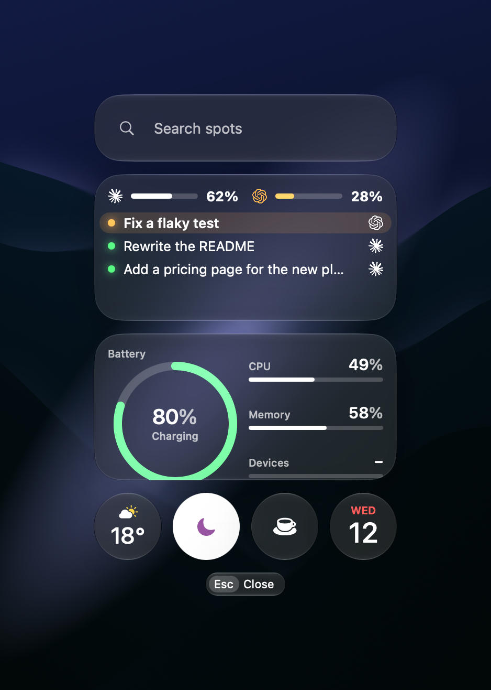

# How Openspot works

**Openspot asks, your spot answers.**

A spot is a small tool in the Openspot panel. Openspot runs your spot with a word, such as `show` or `press`, and your
spot prints what to show.

Start with **[Your first spot](docs/first-spot.md)**: one folder, two files, five minutes.

## Show

- [A list you can press](docs/show/a-list.md)
- [A value on the card](docs/show/the-card.md)
- [Lay out a sheet](docs/show/a-layout.md)

## Act

- [Run an action by name](docs/act/actions.md)
- [Ask for details in a form](docs/act/forms.md)

## Remember

- [Settings people choose](docs/remember/settings.md)
- [Keep your own data](docs/remember/data.md)
- [Keep a copy that goes old](docs/remember/cache.md)

## React

- [Run every minute or on a schedule](docs/react/on-a-schedule.md)
- [Answer when the Mac changes](docs/react/mac-events.md)
- [Answer as people type](docs/react/typing.md)

## Connect

- [Use the Mac: clipboard, screen, timers](docs/connect/the-mac.md)
- [Use another spot](docs/connect/other-spots.md)

## Go further

- [Keep your spot running](docs/further/staying.md)
- [Write it in JavaScript](docs/further/javascript.md)
- [Write it in Swift](docs/further/swift.md)
- [Draw your own view](docs/further/views.md)
- [Share your spot](docs/further/share.md)

## Reference

- [spot.toml](docs/reference/spot-toml.md)
- [What your script prints](docs/reference/blocks.md)
- [Classes](docs/reference/classes.md)
- [The openspot command](docs/reference/commands.md)

## Versions

This is version `3.0` of the protocol, a draft. A new word raises the minor number, such as `3.1`. A change that breaks
a spot raises the major number, such as `4.0`. While it's a draft, a word may still change what it means.

An older Openspot skips a word it doesn't know in what your script prints. It won't load a spot whose `spot.toml` has
a key it doesn't know.
