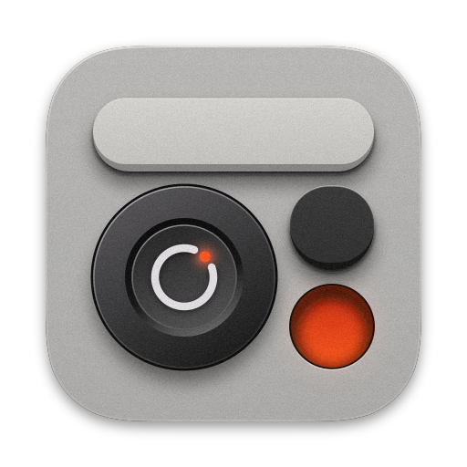
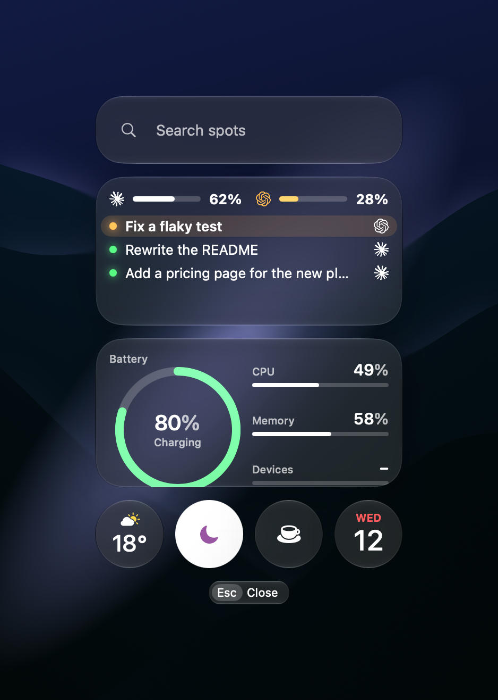
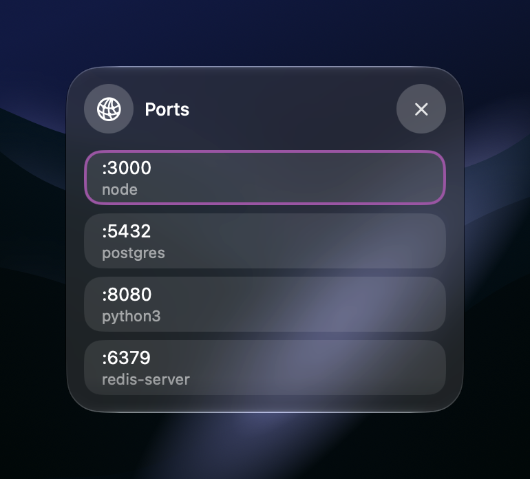

<div align="center">
  
  <h1>Openspot</h1>
  <p><strong>The macOS launcher that your coding agent extends.</strong></p>
  <p>
    <a href="https://github.com/celishq/openspot/releases/latest">Download</a> ·
    <a href="GUIDE.md">Documentation</a> ·
    <a href="CONTRIBUTING.md">Contributing</a> ·
    <a href="#roadmap-and-status">Roadmap</a>
  </p>
</div>

<br>

<!-- Demo video: replace the picture below with the video link from GitHub's editor. -->
<p align="center"></p>

## About

If you use coding agents, you've probably started making small tools for yourself, like something that watches your
pull requests or a controller for the lamps in your room. On macOS, each of those quietly turns into an app, and that's
where it gets annoying, with permission prompts for every new one, a paid Apple developer account just to send it to a
friend, and another Xcode build whenever you want to change a line.

Openspot is the launcher we built so these tools don't have to be apps. Each tool (we call them spots) is just an
executable that prints a few lines of plain text, and Openspot turns that into native UI on a panel you open with a
hotkey, with cards, lists, buttons and search results that look like they belong on a Mac. When a script needs more, it
can bring its own SwiftUI view, and when it needs the system, the `openspot` command gives it the screen, the
clipboard, calendars, windows and more as we add them.

If this sounds a bit like [SwiftBar](https://github.com/swiftbar/SwiftBar) or [Hammerspoon](https://github.com/Hammerspoon/hammerspoon), it is, and we've used both a lot. SwiftBar showed us how far you can
get with stdout, but it lives in the menu bar, and Hammerspoon gives you the macOS APIs, but in Lua and mostly in one
big config. Openspot sits somewhere in between.

## Features

- Write a spot in whatever you like (shell, Python, Swift, Go) and check its output right in the terminal
- Liquid Glass, keyboard navigation and search come with every spot, with no UI code
- Agents are good at writing spots, since a spot is just a CLI with text in and text out
- Permissions live with Openspot, so a new tool doesn't mean a new round of prompts
- Hot reload, so a change shows up a few seconds after you save
- A spot is one signed file you can drop in a chat, with no Apple developer account or notarization involved

## Download

1. Download the [latest release](https://github.com/celishq/openspot/releases/latest). It needs macOS 26 or later.
2. Open the disk image and drag Openspot to Applications.
3. Open it and hit `⌃Space`. That's it.

## Your first spot

A spot is just a script that prints a few lines, and Openspot draws them. Here's a small one that lists whatever is
listening on a port and kills the process when you pick it, which comes in handy when something is sitting on
:3000. Save it as `ports.spot/ports.sh`, with this `ports.spot/spot.toml` beside it, and open it with
`openspot playground open ports.spot/ports.sh`:

```toml
title = "Ports"
icon = "network"
```

```sh
#!/bin/sh
. "$OPENSPOT_SH"
[ "$1" = press ] && kill "$(value item)"
lsof -nP -iTCP -sTCP:LISTEN | awk 'NR > 1 && !seen[$2]++ {
  sub(/.*:/, ":", $9)
  printf "item=%s\ntitle=%s\ndetail=%s\n\n", $2, $9, $1
}'
```

<p align="center"></p>

That's most of the model. The [guide](GUIDE.md) goes through the rest (lists, buttons, cards, your own SwiftUI views)
one task at a time, the [protocol](PROTOCOL.md) has every rule, and [Use Openspot](USING.md) shows the keys, the
places and the themes that you choose.

## Security

Security is a bit of a tradeoff here. Anything you write yourself runs with Openspot's permissions, which we call yolo
mode, while spots from other people run in a sandbox through `sandbox-exec`. We know it's deprecated, but Bazel, Nix and
Codex CLI still rely on the same Seatbelt sandbox, and every spot ships as source anyway, so you or your agent can read
it before you add it. [TRUST.md](TRUST.md) says what Openspot shows you about a spot, and what a spot can and can't
reach.

## Contributing

Fixes and new spots are very welcome. Please skim [CONTRIBUTING.md](CONTRIBUTING.md) before you open a pull request,
it's short and it explains how to build the app and what to run before you push.

## Roadmap and Status

Openspot is in beta, and we use it every day, but the protocol is still a draft, and version 2.0 is going to break it
once.

|  #  | Step                                                    | Status |
| :-: | ------------------------------------------------------- | :----: |
|  1  | A native launcher whose tools are executables           |   ✅   |
|  2  | The macOS APIs as a CLI, with more APIs coming          |   🚧   |
|  3  | Signed spots, with others' spots in a sandbox           |   ✅   |
|  4  | Protocol 2.0, stable                                    |   🚧   |
|  5  | A store on Nostr                                        |   🚧   |
|  6  | Any spot in any place: panel, menu bar, floating window |   ❌   |
|  7  | Per-spot permissions, enforced by Openspot              |   ❌   |
|  8  | macOS before 26                                         |   ❌   |

#### Protocol 2.0

The current [protocol](PROTOCOL.md) grew one feature at a time, and it shows. For 2.0 we're rebuilding it around a
single idea, where a spot gets one message in through its arguments and stdin and prints frames out, and whatever a
spot says about itself moves from comments in the script into a `spot.toml`. We'll migrate every spot that ships with
Openspot, yours will need a small change, and after 2.0 only a major version is allowed to break a spot.

#### A store on Nostr

Spots are already signed with Nostr keys, and the store is going to live on Nostr too, because we don't want to be the
ones who decide what people can share. You'll be able to run your own relays.

#### Per-spot permissions

Right now a spot lists the APIs it uses, and Openspot shows you each use after the fact. The next step is for Openspot
to refuse any call that the spot didn't declare.

## License

MIT, see [LICENSE](LICENSE). The core will stay free.
