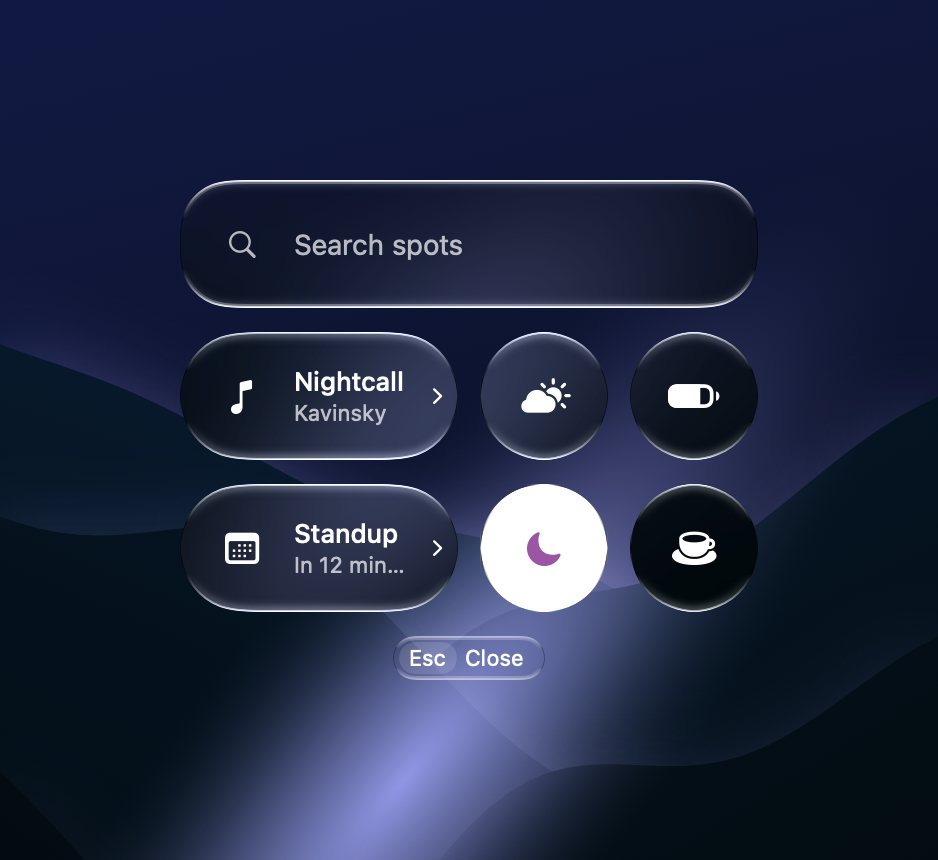

  
  <h1>Openspot</h1>
  
<strong>The macOS launcher that grows with you.</strong> Each tool is one file that you can send to a friend.

  

    <a href="https://github.com/celishq/openspot/releases/latest">Download</a> ·
    <a href="GUIDE.md">Make a tool</a> ·
    <a href="CONTRIBUTING.md">Contribute</a>
  

  Requires macOS 26 or later.

 

Openspot is a minimal launcher for your Mac, like Spotlight. Tell your coding agent what a tool should do, and a moment
later it is in your launcher. You need no Xcode, no developer account and no release.

## Features

- **Fastest.** Openspot opens the instant you press your key, and it stays light on your Mac.
- **Made for agents.** Describe the tool you want, and your agent knows how to build it.
- **Easy to share.** Send a tool to a friend as one file. They see what it does before they add it.
- **Yours to shape.** Move and resize the cards, or give a tool a look of its own.
- **Any language.** Write a tool in shell, Python, Swift or whatever you like.

## Get started

1. Download the [latest release](https://github.com/celishq/openspot/releases/latest).
2. Open the disk image and drag Openspot to Applications.
3. Open Openspot and press `⌃Space`. You can change the key in Settings.

## License

[MIT](LICENSE)
