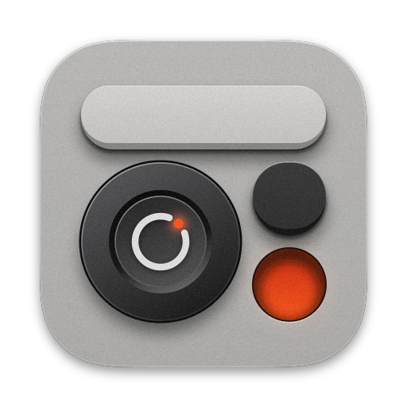

<div align="center">
  
  <h1>Openspot</h1>
  <p><strong>Minimal, native macOS launcher that your agent extends.</strong><br>Each tool is one file that you can send to a friend.</p>
  <p>
    <a href="https://github.com/celishq/openspot/releases/latest">Download</a> ·
    <a href="spec/README.md">Make a tool</a> ·
    <a href="CONTRIBUTING.md">Contribute</a>
  </p>
  <sub>Requires macOS 26 or later.</sub>
</div>

<br>

Openspot is a minimal launcher for your Mac. Think Winamp, for Mac launchers.

Need a tool for one job, or for one day? Tell your coding agent what it should do. A moment later, the tool is in your launcher. You need no Xcode, no developer account and no release.

Openspot gives each tool the same clean look and the power of your Mac. Your tools shape the rest. When a tool works, send it to a friend. They see what it does and add it, with nothing else to install.

## Features

- **Small.** Only 7 MB on your Mac.
- **Fast.** Openspot draws the panel when it starts, so it opens the moment you press your key.
- **One look.** A tool prints data, and Openspot draws it. So each tool looks like part of your Mac.
- **Any language.** Write tools in shell, Python, Swift or any language you like. A Swift tool can even open its own window.
- **Real power.** A tool can stream a long job, or stay running and talk to another process, such as a local server.
- **Made for agents.** One guide tells your agent all that it needs.
- **Safe to share.** Send a tool as one file. Your friend sees what it runs before they add it.

## Get started

1. Download the [latest release](https://github.com/celishq/openspot/releases/latest).
2. Open the disk image and drag Openspot to Applications.
3. Open Openspot and press `⌃Space`. You can change the key in Settings.

## Make your own tool

**Ask your agent from Openspot.** Press `⌘N` in the panel, type what the tool should do, and press Enter. Openspot copies a
prompt with all that your agent needs. Paste it into Claude Code, Codex or another agent, and the tool shows when the agent
saves it.

**Ask your agent anywhere.** Paste this into your coding agent, and change the last line:

```text
Read https://raw.githubusercontent.com/celishq/openspot/main/spec/README.md and each spec it links.
Then make an Openspot tool in ~/.config/openspot/plugins that shows the weather here.
```

**Make one yourself.** Press `⌘N` and pick a starter, or save this as `~/.config/openspot/plugins/hello.sh` and run
`chmod +x` on it. It shows at once.

```sh
#!/bin/sh
# title=Hello
# icon=hand.wave
echo "toast=Hello"
```

**Fix it.** A tool that does not load keeps its card. Press Enter on the card, then `⌘⏎` to copy a prompt that has your agent fix it.
Select any of your tools and press `⌘K` for Edit, Copy prompt for AI, Share and Delete, which `⌘Z` undoes.

**Share it.** Select the tool in the panel and press ⌘⇧C. Then paste the `.spot` file into a chat.

**Add one you got.** Double-click the `.spot` file, read what it runs and press ⌘⏎.

The [`plugins`](plugins) folder has more tools to copy, such as battery, windows and a color picker.
The [`examples`](examples) folder has tools that draw their card with their own SwiftUI view, as [spec 03](spec/03-views.md)
describes, Relay, which stays running and sends lines to another process, as [spec 05](spec/05-stay.md) describes,
Repos, which names a folder and an editor as settings that Settings lists and changes, Agents, Pull requests and World
clock, which show in the menu bar, and Shelf, which keeps the files that you drop on it until you drag them out again, as
[spec 07](spec/07-files-out.md) describes. Doom is a tool that downloads and builds the first episode of Doom on its first
run, then plays it in a window of its own.

## Widgets and keys

A widget shows the live values of several tools on one card. Write it in a `.toml` file in the plugins folder:

```toml
[[widgets]]
title = "Morning"
grid = ["a a b b", "a a c c", "a a d d"]
places = { a = "memory", b = "battery", c = "cpu", d = "disk" }
opens = "links"
```

`grid` draws the card in letters, one line for each row, and each letter is one place. `places` names one tool for each
letter, by its ID: its path with no extension, such as `cpu` or `home/coffee`. A widget in a folder with its tools names
them by file name alone, and the whole folder is shared as one. `opens` names the tool that a click opens, and that tool
has no card of its own.

Settings gives a key to each command that a tool lists. It writes the key to `~/.config/openspot/config.toml`, and you can
write it there by hand too:

```text
[[keys]]
spot = "music"
command = "pause"
key = "ctrl+option+p"
```

A tool whose header says `float=true` can float: Settings lists a Float row for it, and a key with no `command` shows
its sheet, or its card, in a small window at the pointer that stays while you work in other apps, until the same key
closes it. `key = "shake"` takes a quick shake of the pointer in place of a key, so that a shake while you drag files
opens Shelf under them:

```text
[[keys]]
spot = "shelf/shelf"
key = "shake"
```

## License

[MIT](LICENSE)
