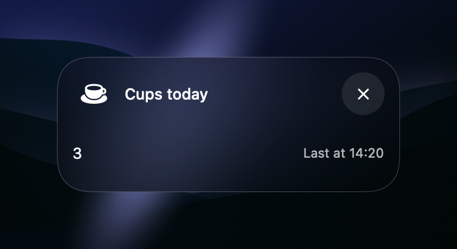

# Your first spot

You'll build Ports: a list of the programs that listen on a port, such as a server you forgot on :3000. Press a row,
and that program stops.



## Make the folder

A spot is a folder with two files. Make the folder in `~/.config/openspot/spots`:

```text
~/.config/openspot/spots/
  ports.spot/
    spot.toml
    ports.sh
```

`spot.toml` gives your spot its name and icon:

```toml
title = "Ports"
icon = "network"
```

The icon is the name of any [SF Symbol](https://developer.apple.com/sf-symbols/), or an emoji.

## Write the script

`ports.sh` does the work:

```sh
#!/bin/sh
case "$1" in
  show)
    lsof -nP -iTCP -sTCP:LISTEN | tail -n +2 | sort -u -k2,2 |
      while read -r name pid _ _ _ _ _ _ address _; do
        printf 'item=%s\ntitle=:%s\ndetail=%s\n\n' "$pid" "${address##*:}" "$name"
      done
    ;;
  press)
    pid=$(sed -n 's/^input.item=//p')
    kill "$pid"
    ;;
esac
```

Make it executable:

```text
chmod +x ~/.config/openspot/spots/ports.spot/ports.sh
```

Press `⌃Space`. Ports is in the panel. Press it to see the list.

## How it works

Openspot asks, your spot answers.

When you open Ports, Openspot runs `ports.sh show`. The script prints one block for each port:

```ini
item=4120
title=:3000
detail=node

item=812
title=:5432
detail=postgres
```

Each block is a few `key=value` lines, and a blank line ends it. `item=` starts a row and gives it an id. `title` and
`detail` are the two lines you see.

When you press a row, Openspot runs `ports.sh press` and sends the row's id on stdin:

```ini
input.item=4120
```

That's the whole idea. Every other page adds one more word Openspot can ask, or one more thing your spot can print.

## Try it from the terminal

You don't need the panel to test a spot. Run it the way Openspot does:

```text
openspot spot run ports show
```

It prints what your script printed. If something's wrong, these help:

```text
openspot check spots ~/.config/openspot/spots
openspot spot log ports
```

`check` names each mistake, such as a key Openspot doesn't know. `log` shows the last runs, with what went in and what
came out.

## The same idea in JavaScript

A spot can also be one JavaScript file. Openspot runs it inside the app, so it answers instantly, but it can't start
other programs. That's why Ports is a script. Here's a spot that shows the time in three cities:

`clocks.spot/spot.toml`:

```toml
title = "Clocks"
icon = "globe"
```

`clocks.spot/clocks.js`:

```js
export default {
  async show() {
    return ["Europe/Paris", "America/New_York", "Asia/Tokyo"].map((zone) => ({
      item: zone,
      title: new Date().toLocaleTimeString("en-GB", { timeZone: zone, hour: "2-digit", minute: "2-digit" }),
      detail: zone.split("/")[1].replace("_", " "),
    }))
  },
}
```

Instead of printing lines, `show` returns one object for each row. The keys are the same: `item`, `title`, `detail`.

## Next

Pick what you want your spot to do from [the map](../PROTOCOL.md).
