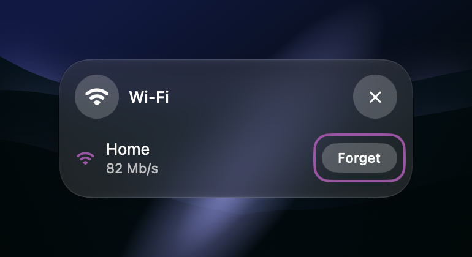

# Lay out a sheet

A list isn't always the right shape. You'll build a row for your Wi-Fi: its icon, the network's name and speed, and a
Forget button at the end.

## The spot

`wi-fi.spot/spot.toml`:

```toml
title = "Wi-Fi"
icon = "wifi"
```

`wi-fi.spot/wi-fi.sh`:

```sh
#!/bin/sh
printf 'frame=\nclass=gap-part\n\nbox=head\nclass=flex-row items-center gap-2\n\n'
printf 'icon=wifi\nparent=head\nvalue=wifi\nclass=text-accent\n\n'
printf 'text=name\nparent=head\ntitle=Home\ndetail=82 Mb/s\nclass=grow\n\n'
printf 'button=forget\nparent=head\ntitle=Forget\nclass=rounded-full\n'
```



The sheet shows one row: the Wi-Fi icon in your accent colour, Home with 82 Mb/s under it, and a Forget chip at the
end. Press Forget, and Openspot runs `wi-fi.sh forget`.

## How it works

The script prints these blocks:

```ini
frame=
class=gap-part

box=head
class=flex-row items-center gap-2

icon=wifi
parent=head
value=wifi
class=text-accent

text=name
parent=head
title=Home
detail=82 Mb/s
class=grow

button=forget
parent=head
title=Forget
class=rounded-full
```

Each block's first line says what it is: a `box`, an `icon`, some `text` or a `button`. The word after the `=` is its
id.

`box=head` holds every block whose `parent` is `head`. They keep the order you print them in.

`class` says how a block looks, with the class names of Tailwind CSS. `flex-row` lays the box out in a row,
`items-center` centres its blocks, and `gap-2` puts 8 points between them. `grow` lets the words take the free width,
which pushes the chip to the end. `rounded-full` makes the button a chip.

Sizes and colours come from the person's theme, so your sheet looks right in any of them. `text-accent` is the theme's
accent colour, and `gap-part` the gap of Openspot's own sheets.

## The classes you'll use most

| Class                                  | Is                                         |
| -------------------------------------- | ------------------------------------------ |
| `flex-row`, `flex-col`                 | A row, or a column, which a box is by default. |
| `grid grid-cols-<n>`                   | A grid of `<n>` columns.                   |
| `items-center`, `justify-between`      | Where a box places its blocks.             |
| `gap-<s>`, `p-<s>`                     | The space between blocks, and inside one.  |
| `grow`                                 | A block that takes the free space.         |
| `hidden`, `flex`                       | A block that doesn't show, and one that does. |
| `text-secondary`, `text-good`, `text-bad` | The colour of the words.               |
| `bg-tile`, `rounded-full`              | A tile behind a block, and round corners.  |

`<s>` is a step of Tailwind's scale, 4 points each. [Classes](../reference/classes.md) lists every class.

## Change a class in one place

Put a word and a colon before a class, and it applies only there:

```ini
button=forget
parent=head
title=Forget
class=rounded-full dark:bg-accent card:hidden
```

Now the chip takes the accent colour when the Mac is in dark mode, and it doesn't show on the spot's card.

| Before a class                                   | Applies                                   |
| ------------------------------------------------ | ----------------------------------------- |
| `card:`, `bar:`, `sheet:`                        | On the card, in the menu bar, on the sheet. |
| `small:`, `wide:`, `square:`, `strip:`, `large:` | On a card of that size.                   |
| `dark:`, `light:`                                | In that appearance of the Mac.            |
| `hover:`, `pressed:`, `selected:`                | While the pointer is over it, it's pressed, or its row is selected. |

## A list beside other blocks

An `items` block is the list itself. Rows whose `parent` is the `items` block are its rows, and you can still search
and press them:

```ini
items=networks

item=office
parent=networks
title=Office
detail=54 Mb/s
```

Add these lines after the row above, and a list of one network, Office, shows under it.

A frame holds one `items` block at most, and an `items` block alone gives the frame a layout. With
`class=grid grid-cols-4`, it shows its rows as tiles. A `box` inside it is a group, headed by its `title`.

A `button` whose `parent` is the `items` block is something you do to the selected row. It shows only in the row's
`⌘K` menu, as on [a list](a-list.md#buttons-on-a-row), and not on the sheet.

## Next

- [A value on the card](the-card.md) uses `card:` to put a value on the card.
- [Classes](../reference/classes.md) lists every class and every word before one.
