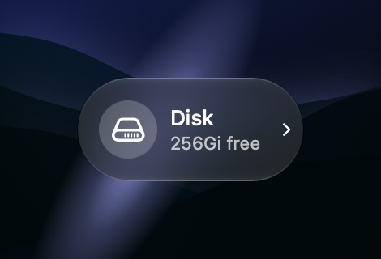

# A value on the card

You'll build Disk: the free space on your Mac, right on its card, so you see it each time you open the panel.

## The spot

`disk.spot/spot.toml`:

```toml
title = "Disk"
icon = "internaldrive"

[on]
"panel.open" = true
every = 300
```

`disk.spot/disk.sh`:

```sh
#!/bin/sh
case "$1" in
  show | every)
    free=$(df -h / | awk 'NR==2 {print $4}')
    printf 'frame=\ndetail=%s free\n\nitem=free\ntitle=%s free\n' "$free" "$free"
    ;;
esac
```

<!-- card: wide -->
<!-- draw: df() { printf 'Filesystem Size Used Avail\n/dev/disk 994Gi 738Gi 256Gi\n'; }; . "$EXAMPLE" -->


The card shows Disk, with the free space under it.

## How it works

`[on]` tells Openspot when to run your script without being asked. It runs `disk.sh show` each time the panel opens,
and `disk.sh every` every 300 seconds while the card shows. Both print the same thing here.
[Run every minute or on a schedule](../react/on-a-schedule.md) has the rest.

The script prints a first block that starts with `frame=`. It isn't a row. It holds what the card shows:

```ini
frame=
detail=256Gi free
```

The card always shows your spot's icon and title. `detail` in the `frame=` block replaces the line under it. A `title`
there would replace the title too.

A press on the card does what Return does. If the card shows a `switch`, a press on it flips it.

## Show a number

A card can show more than a line of words. Give a block a class that starts with `card:`, and the card draws that block
in place of the line:

```ini
frame=

number=used
title=Disk
value=58
max=100
unit=%
type=ring
class=card:flex bar:flex
```

The card shows a ring, 58% full. Without `type`, it shows the number as words, `58%`.

`class` takes the class names of Tailwind CSS. `card:flex` means "show this on the card". [Lay out a sheet](a-layout.md)
has the rest.

When the card shows more than one value, `value=<id>` in the `frame=` block names the one it leads with.

## Card sizes

People choose the size of each card in Edit Spots, the view where they arrange the panel. Each size is a word you can
put before a class, as `card:` is:

| Size     | Is                                  |
| -------- | ----------------------------------- |
| `small`  | One cell, the size most cards have. |
| `wide`   | Two cells side by side.             |
| `square` | Two cells by two.                   |
| `strip`  | Four cells in a row.                |
| `large`  | Four cells by two.                  |

A ring that only fits a big card takes `class=hidden square:flex large:flex`: hidden, except on a square or a large
card.

## The menu bar

People turn on Show in the menu bar in your spot's Settings. With no `bar:` class, the menu bar shows your spot's icon.

Give a block `bar:flex`, as the number above has, and the menu bar shows it next to the clock: a small ring for a ring,
the last 8 bars of a `series`, or the title of a row after a dot of its `tone`.

## The panel's own search

Your spot can answer in the panel's search field, before anyone opens it. Give `[on]` a `search`: a pattern of the
text it answers.

`hex.spot/spot.toml`:

```toml
title = "Hex"
icon = "number"

[on]
search = "^0x[0-9a-fA-F]+$"
```

`hex.spot/hex.sh`:

```sh
#!/bin/sh
case "$1" in
  search)
    text=$(sed -n 's/^input.text=//p')
    printf 'item=%s\ntitle=%d\ndetail=%s in decimal\n' "$text" "$text" "$text"
    ;;
esac
```

Type `0xff` in the panel, and a row, 255, shows at the top.

Openspot runs `hex.sh search` at each key that makes the text match, with the text as `input.text`. The rows you print
join the search. `search = true` instead adds the rows of your spot's `show` to the search.

## Next

- [Lay out a sheet](a-layout.md) places blocks on the card and the sheet.
- [Run every minute or on a schedule](../react/on-a-schedule.md) keeps the value fresh.
